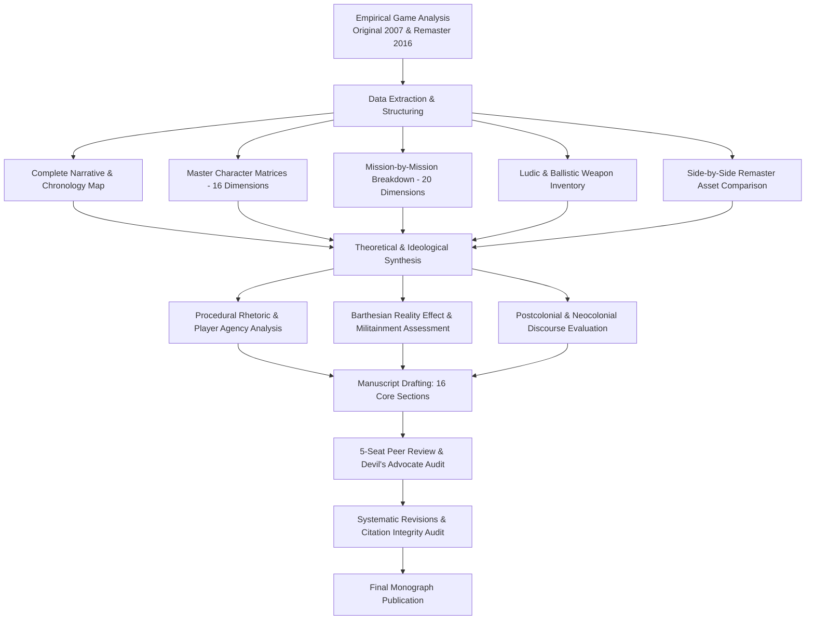

# 01. Research Brief & Methodology Blueprint

## 1. Project Identification & Scope
- **Working Title:** Modern Warfare Before the Modern War: Narrative Construction, Military Representation, Political Ideology, and Player Experience in *Call of Duty 4: Modern Warfare* (2007) and *Modern Warfare Remastered* (2016)
- **Primary Field:** Game Studies / Ludology
- **Interdisciplinary Touchpoints:** Military Studies, Media & Cultural Studies, Political Science & International Relations, Narrative Theory, Audiovisual Studies, Digital Humanities
- **Citation Format:** APA 7th Edition
- **Target Manuscript Length:** 9,000–11,000 words (excluding references, tables, and appendices)

---

## 2. Central Problem Statement & Intellectual Objective
Released in November 2007, Infinity Ward’s *Call of Duty 4: Modern Warfare* represented a pivotal turning point in interactive military entertainment. Breaking away from the saturated World War II setting that characterized early 2000s first-person shooters, the title constructed a fictional, contemporary geopolitical conflict situated within the cultural and psychological anxieties of the post-9/11 "War on Terror." Rather than adopting a singular heroic perspective, the game fragmented the player's agency across multiple distinct military and non-military viewpoints, combining high-speed combat with moments of disorienting helplessness, nuclear catastrophe, and detached remote surveillance. In 2016, Raven Software released *Call of Duty: Modern Warfare Remastered*, updating the game with physically-based rendering, dynamic lighting, re-recorded spatial audio, and rebuilt character assets while maintaining the underlying movement timing and scripted campaign architecture.

This project investigates:
1. How *Call of Duty 4* combined cinematic storytelling, multi-protagonist focalization, scripted mission design, mechanical violence, and audiovisual realism to construct an interactive representation of modern war.
2. How the game negotiated the tension between technical authenticity and politically simplified ideological framing (the "Reality Effect" serving neocolonial or militarist narratives).
3. How the 2016 Remaster altered the reception and affective resonance of this original cultural artifact by wrapping a 2007 geopolitical narrative in modern audiovisual fidelity.

---

## 3. Central & Supporting Research Questions

### Central Research Question (CRQ)
> **How does *Call of Duty 4: Modern Warfare* construct and communicate its representation of modern warfare through parallel playable perspectives, character development, mission design, military mechanics, geopolitical narratives, and cinematic presentation, and how does its 2016 remaster reshape the experience and meaning of this foundational work?**

### Supporting Research Questions
- **RQ1 (Narrative Architecture):** How does the campaign construct its overarching narrative across parallel operational theatres, temporal jumps (1996 vs. 2011), and mission-based focalization?
- **RQ2 (Character Development & Focalization):** How do characters like Soap MacTavish, Paul Jackson, Captain Price, Gaz, and Griggs develop across the campaign, and how do their roles shape the interpretation of soldierly duty and sacrifice?
- **RQ3 (Mission Construction):** How does each of the 21 individual campaign missions establish its specific pacing, ludonarrative objectives, emotional tension, and ethical stakes?
- **RQ4 (Military Perspectives & Theatres):** How does the game differentiate between British Special Air Service (SAS) covert precision operations, United States Marine Corps (USMC) combined-arms urban ground intervention, and detached aerial gunship operations?
- **RQ5 (Geopolitical Representation & Ideology):** In what ways does the game construct the dual-threat axis of Russian Ultranationalism and Middle Eastern revolution, and how does this reflect post-Cold War and post-9/11 Western geopolitical anxieties?
- **RQ6 (Realism, Authenticity & The Reality Effect):** How do weapon ballistics, military jargon, tactile reload animations, and ambient environmental debris generate Roland Barthes’ *effet de réel* to validate a fictionalized conflict?
- **RQ7 (Player Identity & Distributed Agency):** What are the narrative and ethical ramifications of shifting the player's subjectivity from an active SAS operative to a doomed US Marine, an executed civilian head of state, and an emotionally detached thermal gunship operator?
- **RQ8 (Violence, Procedural Rhetoric & Agency):** How do linear scripting, invisible corridors, and forced combat objectives structure the player's relationship with state-sanctioned violence?
- **RQ9 (Affective Trajectory & Emotional Impact):** How does the game modulate player emotions—moving between tactical empowerment, claustrophobic vulnerability, apocalyptic shock (*Shock and Awe* / *Aftermath*), and tragic loss (*Game Over*)?
- **RQ10 (Developer Intent & Production History):** What were Infinity Ward’s creative, technical, and political motivations in pivoting away from World War II, and how did development iteration (the 2006 "mid-production reboot") reshape the campaign?
- **RQ11 (Remastering, Materiality & Memory):** How does Raven Software’s 2016 reconstruction alter the aesthetic, physical, and ideological resonance of the original text through PBR shaders, rebuilt models, and spatial sound?
- **RQ12 (Cultural Legacy & Militainment):** How did *Modern Warfare* solidify the contemporary military-entertainment complex (militainment) and set the design template for subsequent 21st-century military media?

---

## 4. Theoretical Framework
The study integrates five interconnected theoretical lenses:
1. **Critical Game Studies & Procedural Rhetoric (Ian Bogost, Jesper Juul):** Analyzing how the rules, control schemes, hitboxes, recoil parameters, and scripted fail-states convey arguments about modern combat efficiency and ideological necessity.
2. **The "Reality Effect" and Semiotic Realism (Roland Barthes, Kha Dung Cao):** Examining how superfluous military signifiers (military callsigns, weapon dust covers, ambient radio chatter) produce an aura of incontrovertible documentary realism that masks narrative contrivance.
3. **Militainment & Virtuous War (James Der Derian, Matthew Thomas Payne, Tim Lenoir & Luke Caldwell, Nick Robinson):** Interrogating how interactive military games sanitize, celebrate, and normalize clean, high-tech, Western-led pre-emptive violence.
4. **Postcolonial Discourse & Orientalist Framing (Edward Said, Cansu Parlak & Erdinç Kaygusuz, Vit Šisler):** Deconstructing the geopolitical geography of the game, contrasting the rational, professional Western operative with the chaotic, fanatical, or disposable Middle Eastern and Ultranationalist "Other."
5. **Remediation & Software Preservation (Jay David Bolter & Richard Grusin, James Newman):** Evaluating the aesthetic and epistemological consequences of updating legacy game engines with modern physical rendering pipelines.

---

## 5. Methodological Blueprint

### Analytical Matrices Required:
1. **Master Chronology Matrix:** Mapping canonical fictional time (1996 to 2011) against presented mission order.
2. **Comprehensive Character Matrix:** 16-variable systematic evaluation across 13 major figures and supporting squads.
3. **Mission-by-Mission Matrix:** 20-variable evaluation for all 21 campaign missions (prologue through epilogue).
4. **Playable Perspectives Taxonomy:** Analyzing differences in agency, sensory inputs, vulnerability, and complicity across player characters.
5. **Weapon & Ballistics Inventory:** Systematizing the game's firearms, attachments, vehicle fire-support systems, and mechanical traits.
6. **Remaster Comparative Matrix:** Side-by-side asset, engine, lighting, animation, and audio evaluation.
7. **Empirical Claim-and-Evidence Matrix (`15_CLAIM_AND_EVIDENCE_MATRIX.csv`):** Ensuring every analytical claim is anchored to verified in-game dialogue, level geometry, developer statements, or academic citations.

