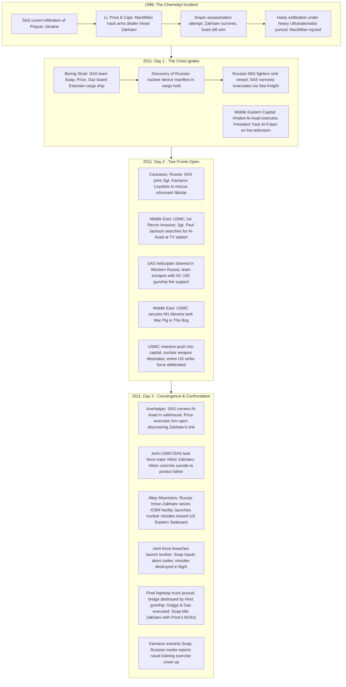

# 05. Complete Narrative Architecture & Chronological Analysis

## 1. Structural Overview: Parallel Theatres & Fractured Temporality
*Call of Duty 4: Modern Warfare* constructs its narrative through a sophisticated architecture of distributed focalization, parallel operational theatres, and cross-cutting temporal planes. Unlike traditional military campaigns that center on a single continuous protagonist traversing a linear sequence of battlefields, *Modern Warfare* distributes its storytelling across two primary elite military formations (the British 22 Special Air Service and the United States Marine Corps 1st Reconnaissance Battalion), interspersed with non-military and remote perspectives.

The narrative architecture operates along three distinct axes:
1. **The Tactical Present (2011):** A rapid, high-stakes 72-hour operational window tracking the convergence of a Middle Eastern military coup led by Khaled Al-Asad and an escalating Ultranationalist civil war in the Russian Federation led by Imran Zakhaev.
2. **The Historical Flashback (1996):** A pivotal two-mission sequence set fifteen years prior in the irradiated ruins of Pripyat, Ukraine, providing the causal origin and ideological motivation for the entire modern crisis through the historical perspective of then-Lieutenant John Price.
3. **The Global Surveillance Web:** Liminal briefing screens, satellite telemetry, intercepts, and radio chatter that frame tactical combat within a sprawling apparatus of international military intelligence.

---

## 2. Chronological Timeline vs. Campaign Presentation Order

### Canonical Chronological Timeline (1996 – 2011)

---

### Comparison Matrix: Chronological Flow vs. Presented Mission Sequence

| Presented Order | Mission Title | Campaign Act | In-Game Date & Time | Fictional Location | Playable Character | Operational Focus |
|---|---|---|---|---|---|---|
| **1** | F.N.G. | Prologue | Day 1 — 07:00 | Credenhill, UK | Sgt. John "Soap" MacTavish | SAS initiation and killhouse evaluation |
| **2** | Crew Expendable | Prologue | Day 1 — 02:00 | Bering Strait | Sgt. John "Soap" MacTavish | Interdiction of cargo ship carrying nuclear package |
| **3** | The Coup | Prologue | Day 1 — 14:00 | Middle Eastern Capital | President Yasir Al-Fulani | Capture, transport, and live public execution |
| **4** | Blackout | Act I | Day 2 — 01:45 | Caucasus Mountains, Russia | Sgt. John "Soap" MacTavish | SAS/Loyalist extraction of informant Nikolai |
| **5** | Charlie Don't Surf | Act I | Day 2 — 13:45 | Middle East (Coastal Town) | Sgt. Paul Jackson | USMC helicopter assault on Al-Asad TV station |
| **6** | The Bog | Act I | Day 2 — 22:05 | Middle Eastern Capital | Sgt. Paul Jackson | Night urban assault to rescue stranded M1 Abrams |
| **7** | Hunted | Act I | Day 2 — 03:02 | Western Russia | Sgt. John "Soap" MacTavish | Evasion through hostile farmland with Nikolai |
| **8** | Death From Above | Act I | Day 2 — 04:20 | Western Russia | AC-130 TV Operator | Aerial thermal fire support for Bravo SAS team |
| **9** | War Pig | Act I | Day 3 — 16:30 | Middle Eastern Capital | Sgt. Paul Jackson | Armored counter-offensive escorting M1 Abrams |
| **10** | Shock and Awe | Act I | Day 3 — 18:30 | Middle Eastern Capital | Sgt. Paul Jackson | Helicopter assault, search for Al-Asad, nuclear blast |
| **11** | Aftermath | Act I | Day 3 — Post-Detonation | Middle Eastern Capital | Sgt. Paul Jackson | Physical dying crawl through radioactive epicenter |
| **12** | Safehouse | Act II | Day 4 — 02:00 | Azerbaijan | Sgt. John "Soap" MacTavish | Village assault, capture, and interrogation of Al-Asad |
| **13** | All Ghillied Up | Act II | 15 Years Ago (1996) | Pripyat, Ukraine | Lt. John Price | Historical deep reconnaissance and assassination |
| **14** | One Shot, One Kill | Act II | 15 Years Ago (1996) | Pripyat, Ukraine | Lt. John Price | Sniper shot on Zakhaev, escape, and Ferris wheel defense |
| **15** | Heat | Act II | Day 4 — 09:40 | Azerbaijan | Sgt. John "Soap" MacTavish | Defensive retreat and extraction from Al-Asad safehouse |
| **16** | The Sins of the Father | Act II | Day 5 — 06:15 | Southern Russia | Sgt. John "Soap" MacTavish | Ambush, pursuit, and cornering of Viktor Zakhaev |
| **17** | Ultimatum | Act III | Day 6 — 06:13 | Altay Mountains, Russia | Sgt. John "Soap" MacTavish | Joint insertion, Griggs rescue, ICBM facility outer perimeter |
| **18** | All In | Act III | Day 6 — 07:16 | Altay Mountains, Russia | Sgt. John "Soap" MacTavish | Heavy combat breach into missile launch facility |
| **19** | No Fighting in the War Room | Act III | Day 6 — 07:35 | Altay Mountains, Russia | Sgt. John "Soap" MacTavish | Underground bunker assault; missile abort sequence |
| **20** | Game Over | Act III | Day 6 — 08:25 | Trans-Caucasus Highway | Sgt. John "Soap" MacTavish | Highway vehicular chase, bridge collapse, killing of Zakhaev |
| **21** | Mile High Club | Epilogue | Classified | 32,000 Feet (Mid-Flight) | Unnamed SAS Operative | VIP hostage rescue aboard hijacked commercial airliner |

---

## 3. Detailed Act-by-Act Narrative Deconstruction

### Prologue: The Stage is Set
The prologue establishes the dual-theatre nature of the conflict and introduces the core mechanics of player competence and helplessness.
- **F.N.G. ("Fucking New Guy"):** Introduces Sergeant John "Soap" MacTavish to Bravo Team of the 22nd SAS Regiment in Credenhill, Herefordshire. Under the dry tutelage of Gaz and the stern scrutiny of Captain John Price, Soap runs the cargo ship training course (the "killhouse"). Mechanically, this sequence calibrates player difficulty and establishes the SAS ethos: surgical speed, economy of motion, and lethal precision.
- **Crew Expendable:** Bravo Team inserts via helicopter onto an unflagged Estonian cargo ship in the storm-tossed Bering Strait. Intelligence indicates the vessel carries illicit cargo destined for the Middle East. The SAS team sweeps the vessel in close-quarters combat, eliminating crew members and discovering a container holding a Russian tactical nuclear warhead with Arabic shipping manifests. Before the package can be secured, Russian MiG-29 fighters attack the ship. In a frantic, flooding escape, Soap misses the helicopter ramp and is grabbed by Captain Price—establishing Price's paternal military authority and personal loyalty to his subordinates.
- **The Coup:** Abruptly shifts perspective to an unnamed Middle Eastern capital. The player does not inhabit a soldier, but the deposed, bruised President Yasir Al-Fulani. Bound in the backseat of an automobile, the player can only turn their head as loyalist soldiers are executed in the streets and citizens flee through gunfire. Transported to a military arena, Al-Fulani is dragged to a stake before a television broadcast camera. Khaled Al-Asad delivers a fiery anti-Western address, flanked by Imran Zakhaev and his son Viktor. Al-Asad raises a Desert Eagle pistol and executes Al-Fulani at point-blank range on live television.

### Act I: The War on Two Fronts
Act I juxtaposes the covert, surgical intelligence gathering of the British SAS with the overwhelming conventional military power of the United States Marine Corps.
- **Blackout:** In the rugged Caucasus Mountains of Western Russia, Bravo Team links up with Sergeant Kamarov and his pro-government Russian Loyalist forces. Their objective is to extract "Nikolai," a deep-cover SAS informant embedded in Zakhaev’s Ultranationalist movement whose cover has been blown. Kamarov repeatedly delays the rescue to use the SAS for sniper fire-support against entrenched Ultranationalists, illustrating the moral compromises and tactical friction of proxy alliances. The team eventually cuts power to a cottage, clears the interior using night-vision goggles, and safely evacuates Nikolai.
- **Charlie Don't Surf:** The US military launches a full-scale amphibious and airborne invasion of the Middle Eastern country to capture Al-Asad and avenge Al-Fulani. The 1st Recon Battalion, led by Lieutenant Vasquez and Staff Sergeant Griggs, conducts an air assault on a coastal town, with the player controlling Sergeant Paul Jackson. The unit assaults a state television studio believed to be broadcasting Al-Asad's speeches, only to discover the broadcasts are pre-recorded looping tapes. The mission title—remediating *Apocalypse Now*—signals the hubristic American assumption of technological dominance over an asymmetric enemy.
- **The Bog:** Later that night, Jackson's unit is diverted into the center of the capital to rescue an isolated M1A2 Abrams main battle tank (callsign "War Pig") stuck in a muddy drainage canal. The Marines endure relentless night attacks by RPG teams and ZPU anti-aircraft guns before Jackson laser-designates enemy positions for close-air support from Cobra attack helicopters.
- **Hunted & Death From Above:** Returning to Russia, the helicopter carrying Nikolai, Price, and Soap is shot down by an Ultranationalist surface-to-air missile. The team must navigate hostile farmlands, evade enemy helicopter searchlights, and eliminate tracking patrols. This ground evasion cross-cuts directly into **Death From Above**, where the player takes control of a thermal TV gunner aboard a circling USAF AC-130H Spectre gunship. Looking down through a black-and-white infrared camera, the player decimates enemy armor and infantry to protect Bravo Team's extraction to a highway junkyard.
- **War Pig:** Returning to the Middle East, the USMC forces successfully extract the repaired "War Pig" tank, using its heavy armor and 120mm smoothbore gun to spearhead an urban offensive through heavily defended residential streets toward an extraction landing zone.
- **Shock and Awe & Aftermath:** The climax of Act I. The US military commits massive airborne forces into the capital to trap Al-Asad's remaining army. As Jackson's CH-46 Sea Knight helicopter provides minigun fire support, a Cobra gunship is shot down behind enemy lines. Defying orders to evacuate immediately, Lieutenant Vasquez orders his squad to land and rescue the injured female pilot, Captain Pelayo. Jackson physically retrieves Pelayo from the wreckage, and the helicopter lifts off. Moments later, Central Command transmits an urgent warning: NEST teams have detected a nuclear warhead arming in the city center. Before the transport can clear the blast radius, the weapon detonates. The shockwave rips the helicopter out of the sky.

In **Aftermath**, Jackson regains consciousness inside the crashed transport amidst dead squadmates. Radiation saturates the screen; buildings burn; a massive nuclear mushroom cloud towers over the ruined cityscape. Stripped of weapons, squad, and sprint mechanics, the player crawls forward for several minutes through ash and mutilated bodies before collapsing onto the dust and dying as Jackson's heart rate monitor flatlines.

### Act II: Retaliation, Memory, and the True Architect
Act II shifts from broad conventional intervention to an intense, covert hunt for the geopolitical mastermind behind the catastrophe.
- **Safehouse:** Acting on intelligence from Nikolai, the SAS team assaults a secluded mountain village in Azerbaijan where Khaled Al-Asad has fled. Supported by Kamarov's Loyalists, the team clears buildings until cornering Al-Asad inside a farmhouse. As Price and Gaz brutally interrogate him, demanding to know where he obtained the nuclear device, Al-Asad's cell phone rings. Price answers, listens silently, and hears the voice of Imran Zakhaev. Realizing Al-Asad was merely a puppet and Zakhaev provided the weapon, Price casually executes Al-Asad with a bullet to the head.
- **All Ghillied Up & One Shot, One Kill:** Price's execution of Al-Asad triggers a fifteen-year memory flashback to 1996. The player controls a young Lieutenant John Price under the command of Captain MacMillan during a black-ops mission in the irradiated ghost city of Pripyat, Ukraine. The British government had authorized Zakhaev’s assassination to halt his smuggling of nuclear materials from the decaying Chernobyl plant. Wearing ghillie suits, Price and MacMillan avoid massive Ultranationalist armor patrols, sniper positions, and attack dogs. Reaching the top floor of the abandoned Hotel Polissya, Price lines up a Barrett .50-caliber sniper shot, adjusting for distance, bullet drop, and Coriolis effect. The high-caliber round severs Zakhaev’s left arm, but fails to kill him. During their escape, an enemy helicopter is shot down, crashing into MacMillan and crushing his legs. Price carries the immobilized MacMillan through apartment courtyards, setting Claymore mines at the Pripyat amusement park's Ferris wheel in an iconic defensive stand before a Sea Knight extracts them.
- **Heat:** Snapping back to 2011, Bravo Team is counter-attacked at the Azerbaijan safehouse by a massive Ultranationalist assault force. Price, Soap, and Gaz conduct a desperate fighting retreat down the mountain slopes, utilizing detonating fuel tanks and close-air support before escaping aboard a Loyalist helicopter.
- **The Sins of the Father:** Joint SAS and USMC elements (with Staff Sergeant Griggs now integrated into the British team) stage an ambush to capture Imran Zakhaev's son, Viktor Zakhaev, at a military checkpoint. Wearing Russian military disguise, the joint team pursues Viktor across rooftops and through an alleyway. Trapped on the roof of a high-rise apartment block, Viktor draws a Makarov pistol and shoots himself in the mouth to avoid interrogation.

### Act III: The Brink of Nuclear Armageddon
Viktor's suicide breaks Imran Zakhaev’s psychological restraint, transforming a calculated political insurgency into a suicidal drive for global nuclear retaliation.
- **Ultimatum:** Bravo Team and USMC survivors parachute into the snow-covered Altay Mountains of Central Russia. They locate and rescue Staff Sergeant Griggs, who had been captured during the drop, and neutralize an electrical sub-station to breach the outer defenses of a Soviet-era intercontinental ballistic missile (ICBM) facility seized by Zakhaev. As the assault begins, Zakhaev launches two RT-2UTTH Topol-M (SS-27) nuclear missiles toward the United States Eastern Seaboard, threatening an estimated 41 million casualties.
- **All In & No Fighting in the War Room:** The joint force mounts an all-out assault against armored vehicles and defensive bunkers to breach the facility's heavy blast doors. In **No Fighting in the War Room** (referencing Stanley Kubrick’s *Dr. Strangelove*), the team navigates narrow underground service corridors under a severe countdown timer. Soap, Price, and Gaz infiltrate the command bunker, where Soap uploads abort codes transmitted by Allied command, detonating both missiles safely in the upper atmosphere over the Atlantic Ocean.
- **Game Over:** In the campaign’s climactic finale, the surviving team flees the facility in military trucks along a mountain highway, pursued by dozens of Ultranationalist technicals and a Mil Mi-24 Hind gunship. A missile from the Hind destroys the bridge ahead, causing the military vehicles to crash. Soap crawls out of the wreckage, severely concussed. As the wounded team lies exposed, Staff Sergeant Griggs drags Soap behind cover before being shot through the head. Imran Zakhaev arrives in an SUV accompanied by bodyguards. Gaz is shot in the head point-blank. Zakhaev and his men walk down the line, executing the helpless soldiers. Just as Zakhaev aims his pistol at Soap, Loyalist helicopters under Sergeant Kamarov arrive, distracting Zakhaev and his guards. A critically wounded Captain Price slides his M1911 pistol across the tarmac to Soap. In a slow-motion first-person sequence, Soap takes aim and shoots Zakhaev and his two bodyguards dead. Kamarov drops onto the bridge, calling medical personnel to lift Soap onto a stretcher, while a Loyalist medic desperately performs CPR on an unresponsive Captain Price. The radio crackles with a Russian news broadcast falsely claiming that an explosion in the Altay Mountains was merely a "routine missile training exercise."

### Epilogue: Mile High Club
Set after the main campaign narrative, a four-man SAS counter-terrorism assault squad breaches a double-deck commercial airliner flying at 32,000 feet. In an intense, 60-second time-attack sequence, the team moves through the cabin, shoots hijackers, breaches the upper deck, and rescues a VIP hostage before jumping from the depressurizing aircraft via parachute. The epilogue serves as a pure mechanical distillation of cinematic special-forces fantasy, deliberately decoupled from the tragic geopolitical consequences of the main campaign.

