# 07. Master Character Relationship Map & Structural Network

This document formalizes the web of command hierarchies, political affiliations, historical rivalries, and tragic fatalities connecting the characters of *Call of Duty 4: Modern Warfare* across the 1996 and 2011 timelines.

---

## 1. Master Factional & Command Network

```mermaid
flowchart TD
    subgraph WESTERN_ALLIANCE["Western Alliance & Coalition Intelligence"]
        subgraph UK_SAS["British 22 Special Air Service (SAS)"]
            Price["Captain John Price<br/>(Bravo Six - Commander)"]
            Soap["Sgt. John 'Soap' MacTavish<br/>(Protégé / Breacher)"]
            Gaz["Gaz<br/>(Second-in-Command / Tech)"]
            MacMillan["Capt. MacMillan (1996)<br/>(Price's Mentor)"]
            Wallcroft["Sgt. Wallcroft"]
            Griffen["Pvt. Griffen"]
        end

        subgraph USMC_1RECON["USMC 1st Reconnaissance Battalion"]
            Vasquez["Lt. Vasquez<br/>(Platoon Leader)"]
            Jackson["Sgt. Paul Jackson<br/>(Playable Rifleman)"]
            Griggs["SSgt. Griggs<br/>(Automatic Rifleman)"]
            Pelayo["Capt. Pelayo<br/>(AH-1W Cobra Pilot)"]
        end

        subgraph USAF_SUPPORT["USAF Special Operations"]
            AC130["AC-130 TV Operator & Crew<br/>(Thermal Air Support)"]
        end
    end

    subgraph RUSSIAN_DIVIDE["Russian Civil Conflict"]
        subgraph LOYALISTS["Russian Loyalist Forces (Government)"]
            Kamarov["Sergeant Kamarov<br/>(Field Commander)"]
            LoyalistTroops["Loyalist Soldiers"]
        end

        subgraph ULTRANATIONALISTS["Russian Ultranationalist Party"]
            Zakhaev["Imran Zakhaev<br/>(Supreme Leader)"]
            Viktor["Viktor Zakhaev<br/>(Field Commander / Son)"]
            InsurgentForces["Ultranationalist Militia"]
        end

        Nikolai["Nikolai<br/>(Undercover SAS Informant)"]
    end

    subgraph MIDDLE_EAST["Middle Eastern Crisis"]
        AlAsad["Khaled Al-Asad<br/>(Rebel Commander / Coup Leader)"]
        AlFulani["President Yasir Al-Fulani<br/>(Deposed Head of State)"]
        OPFOR["OpFor Revolutionary Guard"]
    end

    %% Command Hierarchies
    MacMillan -->|Mentored in 1996| Price
    Price -->|Commands Bravo Team| Soap
    Price -->|Commands Bravo Team| Gaz
    Price -->|Tactical Command| Wallcroft & Griffen
    Vasquez -->|Commands Squad| Jackson
    Vasquez -->|Commands Squad| Griggs
    Zakhaev -->|Commands / Fathers| Viktor
    Zakhaev -->|Finances & Directs| AlAsad

    %% Coalition & Proxy Connections
    Price <-->|Transactional Alliance| Kamarov
    Nikolai -.->|Feeds Intel to| Price & Gaz
    Kamarov -->|Rescues| Nikolai
    Griggs -->|Transfers to Joint Task Force| Price & Soap
    AC130 -->|Protects on Ground| Price & Soap & Nikolai

    %% Antagonistic & Lethal Lines
    Price -.->|Sniper Shot 1996 / Severed Arm| Zakhaev
    Price -->|Executes 2011| AlAsad
    AlAsad -->|Executes on TV| AlFulani
    Zakhaev -->|Launches Nuclear Strike| Jackson & Vasquez
    Zakhaev -->|Executes on Bridge| Gaz
    InsurgentForces -->|Kills on Bridge| Griggs
    Soap -->|Kills with Price's M1911| Zakhaev
    Viktor -->|Suicide to Defy| Soap & Price
    Kamarov -->|Extracts Alive| Soap

    classDef sas fill:#e6f7ff,stroke:#1890ff,stroke-width:2px;
    classDef usmc fill:#f6ffed,stroke:#52c41a,stroke-width:2px;
    classDef antagonist fill:#fff1f0,stroke:#f5222d,stroke-width:2px;
    classDef loyalist fill:#f9f0ff,stroke:#722ed1,stroke-width:2px;
    classDef victim fill:#fffbe6,stroke:#faad14,stroke-width:2px;

    class Price,Soap,Gaz,MacMillan,Wallcroft,Griffen sas;
    class Vasquez,Jackson,Griggs,Pelayo,AC130 usmc;
    class Zakhaev,Viktor,AlAsad,InsurgentForces,OPFOR antagonist;
    class Kamarov,LoyalistTroops,Nikolai loyalist;
    class AlFulani victim;
```

---

## 2. Character-to-Character Relational Dynamics

### A. The Mentorship Axis: MacMillan → Price → Soap
The transmission of professional special-forces tradecraft is generational:
- **MacMillan and Lieutenant Price (1996):** Established in *All Ghillied Up*, MacMillan acts as the archetypal master sniper, training young Price in absolute sensory discipline, environmental patience, and calculated restraint. When MacMillan is crippled, the relationship tests young Price's devotion, cementing Price's foundational belief in squad loyalty over personal survival.
- **Captain Price and Soap MacTavish (2011):** Price replicates MacMillan's mentorship, initially challenging the recruit's competence in *F.N.G.*, but progressively entrusting him with point-man responsibilities. Price catches Soap's hand during the Bering Strait sinking, saves his life in Azerbaijan, and ultimately slides him the weapon that kills Zakhaev. Soap's transformation from novice to veteran completes this pedagogical lineage.

### B. The Anglo-American Bridge: Griggs, Jackson, and Bravo Team
- **Jackson and Griggs (USMC):** Represents the brotherhood of front-line Marine combat. Griggs survives the nuclear detonation because he was assigned to a separate staging element, carrying survivor's guilt into Act III.
- **Griggs and Bravo Team (SAS):** Griggs joins the British SAS in the Altay Mountains. While initial interactions highlight transatlantic cultural differences (Griggs’ outgoing American personality vs. British understated reserve), these distinctions dissolve under fire. Griggs dies shielding Soap, completing the moral integration of the joint coalition.

### C. The Shadow Alliance: Price, Kamarov, and Nikolai
- **Price and Kamarov:** A relationship defined by cynical mutual dependency. Kamarov exploits the SAS’s urgency to rescue Nikolai by forcing them to provide sniper support in *Blackout*. Price responds with open hostility (*"Not funny, Kamarov"*), yet recognizes Kamarov as an indispensable native actor. Kamarov’s dramatic arrival with Mi-28 gunships on the bridge in *Game Over* redeems his earlier opportunism.
- **Nikolai:** The human linchpin connecting all three acts. As an embedded Russian insider, his rescues (*Blackout*, *Hunted*) directly yield the strategic intelligence that enables the pursuit of Al-Asad and Zakhaev.

### D. The Antagonist Hierarchy: Imran Zakhaev, Viktor Zakhaev, and Khaled Al-Asad
- **Imran and Viktor Zakhaev:** Bound by patriarchal devotion and fanatical ideology. Viktor operates as his father’s operational lieutenant. Viktor’s cornered suicide in *The Sins of the Father* is a catastrophic turning point: it shatters Imran Zakhaev’s strategic rationality, triggering the apocalyptic decision to launch intercontinental ballistic missiles.
- **Imran Zakhaev and Khaled Al-Asad:** A classic relationship of cynical proxy manipulation. Zakhaev arms and finances Al-Asad to orchestrate the Middle Eastern coup as a geopolitical diversion, calculating that American forces will become bogged down in the desert while Zakhaev seizes control of the Russian nuclear arsenal. Al-Asad is discarded the moment his utility ends.

---

## 3. Fatality & Consequence Matrix

| Victim | Responsible Agent / Cause | Mission | Narrative & Ideological Consequence |
|---|---|---|---|
| **President Yasir Al-Fulani** | Khaled Al-Asad (Executioner) / Imran Zakhaev (Sponsor) | *The Coup* | Destabilizes the Middle East; provides political justification for full-scale US military intervention. |
| **Captain Pelayo & Keating** | OpFor RPG / SAM Fire | *Shock and Awe* | Prompts the rescue attempt by Jackson and Vasquez, holding the extraction helicopter within the nuclear blast zone. |
| **Lieutenant Vasquez** | Nuclear Detonation (Zakhaev’s Warhead) | *Shock and Awe* | Destroys the USMC command structure, demonstrating the fatal hubris of conventional military intervention. |
| **Sergeant Paul Jackson** | Blast Trauma & Radiation Fall-Out | *Aftermath* | Subverts player empowerment; eliminates the American playable protagonist in an agonizing, anti-heroic demise. |
| **Khaled Al-Asad** | Captain John Price (Pistol Execution) | *Safehouse* | Terminates the Middle Eastern distraction; exposes Imran Zakhaev as the true architect of the nuclear crisis. |
| **Viktor Zakhaev** | Self-Inflicted Gunshot (Suicide) | *The Sins of the Father* | Denies the Allied coalition vital intelligence; drives Imran Zakhaev into suicidal nuclear retaliation. |
| **Staff Sergeant Griggs** | Ultranationalist Gunfire | *Game Over* | Represents the ultimate sacrifice of military brotherhood, dying while pulling the wounded Soap into cover. |
| **Gaz** | Imran Zakhaev (Point-Blank Execution) | *Game Over* | Strips the SAS unit of its humorous, reassuring anchor in a sudden, unglamorous moment of cruelty. |
| **Imran Zakhaev** | Sergeant John "Soap" MacTavish (M1911) | *Game Over* | Avenge the deaths of the squad; halts the Ultranationalist threat; provides climactic narrative closure. |
