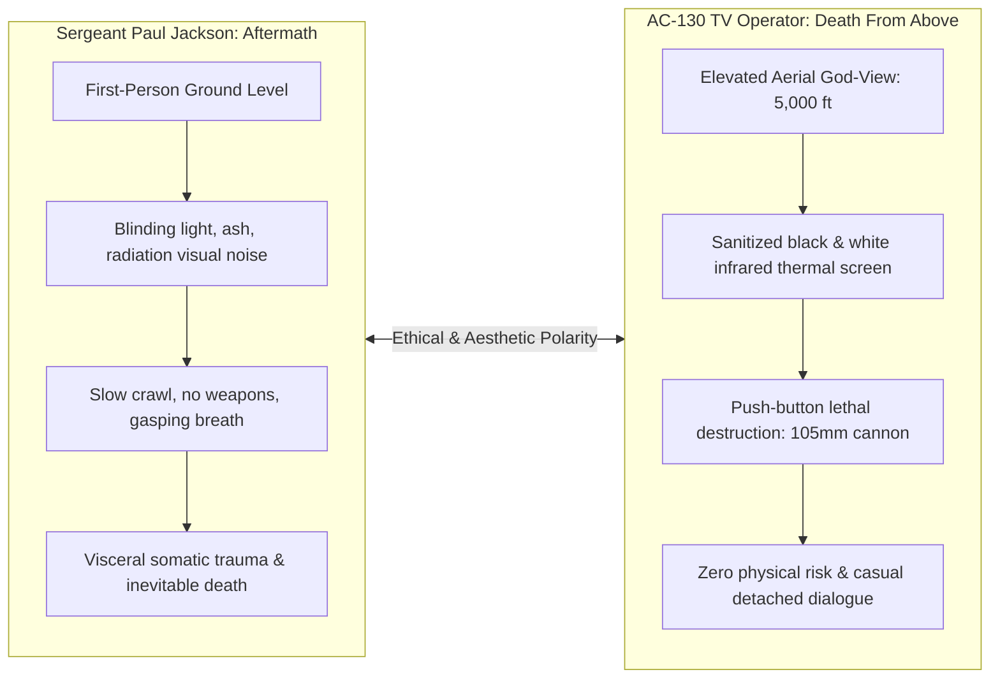

# 08. Comparative Analysis of Playable Perspectives & Distributed Agency

## 1. The Phenomenon of Distributed Subjectivity
One of the defining formal innovations of *Call of Duty 4: Modern Warfare* is its rejection of a singular, continuous protagonist. Rather than consolidating player agency within an omnipotent heroic individual who single-handedly resolves a global crisis, the game distributes player consciousness across **six distinct playable viewpoints**. Each perspective represents a radically different tier of military responsibility, sensory perception, spatial orientation, and physical vulnerability.

This structural fragmentation performs critical ideological and psychological work:
- It mirrors the compartmentalized, networked reality of contemporary military operations.
- It constantly destabilizes the player’s affective relationship with violence, alternating between intoxicating tactical empowerment, paralyzing victimhood, and chilling, dispassionate aerial detachment.

---

## 2. Comparative Matrix of Playable Perspectives

| Playable Entity | Operational Identity | Perspective & Interface | Locomotion & Agency | Affective State | Ideological & Ludic Function |
|---|---|---|---|---|---|
| **Sgt. John "Soap" MacTavish** | British 22 SAS Operative | First-Person; tactical HUD, night-vision, red-dot / ACOG optics | High mobility (sprint, crouch, prone, tactical mantle); full weapon manipulation | Professional urgency, focus, resilience under physical trauma | The professional special-forces ideal: surgical violence, stealth, disciplined execution of state security policy. |
| **Sgt. Paul Jackson** | USMC 1st Recon Rifleman | First-Person; military HUD, smoke grenades, laser designator | Standard infantry mobility; abruptly reduced to zero locomotion in *Aftermath* | Aggressive momentum, disorientation, claustrophobia, agony | The conventional ground combatant: the tip of the imperial spear, ultimately betrayed and discarded by nuclear reality. |
| **Lt. John Price (1996)** | Historical SAS Sniper / Recon | First-Person; suppressed weapons, ghillie concealment meter, sniper scope | Subordinated locomotion; movement strictly dictated by mentor MacMillan | Deep tension, tactical patience, hyper-vigilance, vulnerability | Historical pedigree and generational tradecraft; demonstrates that survival in war requires restraint rather than kinetic action. |
| **President Yasir Al-Fulani** | Deposed Middle Eastern Head of State | First-Person; no crosshair, no weapons, bruised visual distortion | Zero locomotive control; passive passenger in vehicle; forced walking | Absolute helplessness, sensory terror, humiliation, dread | The dehumanized political victim: complete denial of Arab agency, functioning as an aesthetic spectacle to validate Western intervention. |
| **AC-130 TV Operator** | USAF Aerial Fire Control Officer | Top-down thermal infrared CRT monitor (white-hot); 25mm, 40mm, 105mm reticles | Zero physical movement; stationary orbit at 5,000+ feet; pan and zoom camera | Cold emotional detachment, technocratic god-view, casual professional calm | The ultimate manifestation of "Virtuous War": lethal violence transformed into a sanitized, bloodless video game of glowing silhouettes. |
| **Unnamed SAS Operative** | Counter-Terror Assault Specialist | First-Person; stripped HUD, strict 60-second countdown timer | Hyper-accelerated, reflexive, continuous CQB movement | Adrenaline, spatial economy, high-stakes reflexivity | Pure ludic distillation: cinematic action spectacle completely liberated from narrative trauma and geopolitical consequence. |

---

## 3. Deep Case Study: Somatic Ground Vulnerability vs. Aerial Technocratic Detachment

The most profound aesthetic and ethical tension in *Call of Duty 4* emerges from the radical juxtaposition between **Sergeant Paul Jackson in *Aftermath*** and the **AC-130 TV Operator in *Death From Above***.

### A. The Embodied Agony of Paul Jackson in *Aftermath*
In *Aftermath*, Infinity Ward systematically strips away every mechanic that defines the first-person shooter genre:
1. **Erasure of the HUD:** The crosshair, ammunition counter, objective compass, and mini-map vanish, depriving the player of tactical awareness.
2. **Deprivation of Locomotion:** The sprint, jump, and crouch keys are disabled. Jackson cannot stand upright; he can only stumble weakly forward before collapsing to his knees and dragging his body across the irradiated tarmac.
3. **Sensory Trauma:** The audio landscape is drained of gunfire and triumphant music, replaced by the ragged, choking gasps of Jackson’s irradiated lungs and the slow, erratic thumping of his failing heartbeat. The screen is bleached with overexposed white sunlight, falling nuclear ash, and radioactive distortion.
4. **Denial of Victory:** There are no enemies to engage, no allies to rescue, and no objectives to complete. The player is forced to endure several agonizing minutes of physical deterioration, culminating in Jackson collapsing in the dust, witnessing a towering nuclear mushroom cloud, and flatlining.

By forcing the player to inhabit a dying soldier, the game shatters the heroic illusion of American military invulnerability, presenting the raw physical reality of weapons of mass destruction.

### B. The Technocratic Abstraction of the AC-130 Operator in *Death From Above*
Directly preceding the tragic ground missions of Act I is *Death From Above*, which presents the exact inverse of Jackson's visceral suffering:
1. **The Thermal Veil:** The player observes the earth through an infrared FLIR camera orbiting thousands of feet above the Russian countryside. Human beings are rendered as tiny, white, incandescent silhouettes against a cold, gray landscape. When hit by a 105mm high-explosive artillery shell, these human figures do not bleed, scream, or express agony; they simply dissolve into puffs of thermal smoke and ragdoll physics.
2. **The Remediation of Gulf War Broadcasts:** The interface explicitly remediates the iconic television gun-camera footage broadcast during Operation Desert Storm (Der Derian, 2009; Stahl, 2010). The player is insulated from the sensory reality of the violence they inflict.
3. **Casual Professionalism:** The flight crew engages in chillingly banal professional banter:
   - *"Yeah, good kill. Mark that one down."*
   - *"Kaboom."*
   - *"That's a hit. Clean 'em up."*
   - *"You've got civilian vehicles moving on the highway... do not engage."*
4. **Virtuous War in Practice:** The player is invulnerable. There is zero risk of return fire; no enemy surface-to-air missiles threaten the aircraft. Killing is transformed into a tidy administrative chore of pest control.

### Analytical Synthesis
Together, these two playable perspectives expose the dual nature of 21st-century warfare. The AC-130 operator represents the Western imperial fantasy of **Virtuous War**—clean, bloodless, technologically supreme, and completely insulated from physical danger. Jackson in *Aftermath* represents the horrific material reality of the **Dirty War**—visceral, radioactive, mutilating, and lethal. The player is compelled to be both the omnipotent executioner from the sky and the helpless victim on the ground, creating a profound, unresolved ethical dissonance.

---

## 4. The Erasure of Agency: Yasir Al-Fulani in *The Coup*
The inclusion of President Yasir Al-Fulani in *The Coup* is a unique narrative experiment with disturbing ideological implications (Parlak & Kaygusuz, 2025):
- **Forced Passivity:** Unlike any other FPS protagonist, the player cannot move Al-Fulani’s legs, open doors, or raise his hands. The mouse only allows the player to swivel his head within a narrow 180-degree cone.
- **The Tourist of Collapse:** The player is forced to sit in the backseat of a sedan as an unwilling tourist traversing the collapse of a sovereign state. They witness public executions, burning civilian cars, and ecstatic rebel militias shouting in Arabic.
- **The Sacrificial Object:** Al-Fulani is dragged to a bloody post. The player looks up from a low angle as Khaled Al-Asad points a gold-plated Desert Eagle at their forehead. The screen flashes white with the gunshot, and the perspective instantly cuts to black.

As Cansu Parlak and Erdinç Kaygusuz (2025) demonstrate, this sequence denies the Middle Eastern political subject any capacity for action or resistance. Al-Fulani exists in the text solely as a victim whose agonizing execution justifies the subsequent massive deployment of Western Marines in *Charlie Don't Surf*. His death functions not as a tragedy in its own right, but as a narrative engine designed to mobilize Western righteous retribution.

---

## 5. The Ascetic Discipline: Young Price in *All Ghillied Up*
In *All Ghillied Up*, the player inhabits Lieutenant John Price in 1996, experiencing a radical shift from kinetic gunplay to **spatial asceticism**:
- **Subordinated Authority:** The player is completely subordinate to Captain MacMillan. Disobeying his commands (*"Get down!", "Hold your fire", "Wait..."*) results in instantaneous death from roaming armored columns or attack dogs.
- **The Value of Inaction:** Traditional FPS mechanics reward rapid reaction time and high kill counts. *All Ghillied Up* rewards stillness. In the mission's most celebrated sequence, the player must lie motionless in prone position in a ghillie suit while an entire company of Ultranationalist infantry and BMP armored vehicles literally walks over and around them.
- **Tactical Vulnerability:** The player’s sniper rifle is suppressed, but firing without synchronization with thunderclaps or MacMillan’s countdown alerts the entire enemy force. Agency is redefined as the mastery of patience, stealth, and spatial awareness within a contaminated post-Soviet landscape.
