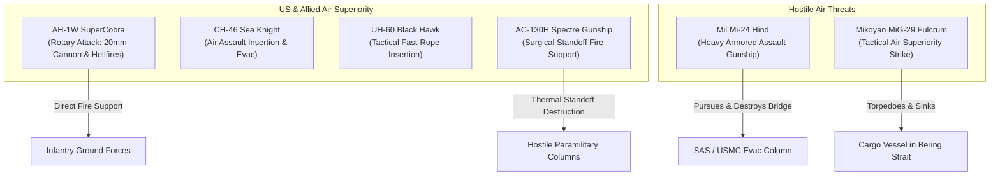

# 10. Military Operations, Weapon Systems & Combat Mechanics

## 1. Overview: The Procedural Rhetoric of Modern Combat
*Call of Duty 4: Modern Warfare* revolutionized the mechanical design of first-person shooters by replacing the floating crosshairs, spongey health pools, and archaic ballistic models of World War II shooters with a tactile, cybernetically responsive combat simulation. Guided by military advisors—including active-duty US Marine combat instructors and former British 22 SAS operators—Infinity Ward engineered a procedural system where lethal violence is fast, punishing, distance-calibrated, and mechanically satisfying (McCandlish & Boon, 2008; Shacknews, 2007).

---

## 2. Comprehensive Campaign Weapon Inventory & Ballistics Matrix

| Weapon Class | Nomenclature | Caliber / Ammunition | Campaign Availability & Users | In-Game Handling & Recoil Dynamics | Ballistic Penetration Tier | Tactical Attachments Featured |
|---|---|---|---|---|---|---|
| **Assault Rifle** | M4A1 Carbine | 5.56×45mm NATO | USMC / SAS Bravo Team | High fire rate (850 RPM), moderate vertical recoil, fast reload | Medium (Sheet metal, drywall, wood) | SOPMOD Suppressor, M203 Grenade Launcher, Aimpoint Red Dot, ACOG 4x |
| **Assault Rifle** | M16A4 | 5.56×45mm NATO | USMC 1st Recon (Jackson, Vasquez) | 3-round burst, minimal recoil, extreme mid-range accuracy | Medium (Drywall, wood, thin metal) | ACOG Scope, M203 40mm Launcher, Iron Sights |
| **Assault Rifle** | AK-47 | 7.62×39mm Soviet | OpFor Middle East, Ultranationalists | Heavy visual recoil, low RPM (600), high per-shot damage | High (Cinderblock, thick wood, metal doors) | Iron Sights, occasional GP-25 Launcher |
| **Assault Rifle** | G3 | 7.62×51mm NATO | Middle Eastern Militia, SAS fallback | Semi-automatic battle rifle, extreme damage, heavy kick | High (Concrete corners, brickwork) | Iron Sights, Red Dot Sight |
| **Assault Rifle** | G36C | 5.56×45mm NATO | SAS Bravo Team (*Safehouse*, *Game Over*) | Compact carbine, clean sight picture, controllable spread | Medium (Sheet metal, plywood) | Red Dot Sight, Holographic |
| **Submachine Gun** | MP5 | 9×19mm Parabellum | SAS Bravo Team (*Crew Expendable*) | Rapid fire (800 RPM), minimal recoil, rapid CQB target acquisition | Low (Fails on brick; penetrates interior doors) | Suppressor, Tactical Flashlight |
| **Submachine Gun** | P90 | 5.7×28mm FN | SAS (*Mile High Club*), Ultranationalists | High magazine capacity (50 rounds), high RPM (900), wide hip-spread | Medium (Kevlar penetration, thin sheet) | Red Dot Sight, Suppressor |
| **Submachine Gun** | Mini-Uzi | 9×19mm Parabellum | Middle Eastern Insurgents, Ultranationalists | Extreme rate of fire (950 RPM), severe vertical climb | Low (Drywall only) | Iron Sights |
| **Submachine Gun** | Skorpion vz. 61 | .32 ACP (7.65mm) | Ultranationalist CQB fighters | Zero recoil, rapid reload, low damage over distance | Low (Fails on metal) | Iron Sights |
| **Light Machine Gun** | M249 SAW | 5.56×45mm NATO | SSgt. Griggs, USMC Fire Support | 100-round belt, high suppression, long reload time (5.8s) | High (Continuous wall shredding) | Iron Sights |
| **Light Machine Gun** | RPD | 7.62×39mm Soviet | Ultranationalist Gunners, OpFor Heavy | Heavy automatic suppression, steady rhythmic recoil | High (Destroys wooden cover) | Iron Sights |
| **Light Machine Gun** | M60E4 | 7.62×51mm NATO | Heavy enemy gunners (*The Bog*, *Heat*) | Massive per-bullet damage, slow fire rate, massive visual kick | Extreme (Penetrates brick, engine blocks) | Iron Sights |
| **Sniper Rifle** | M21 Suppressed | 7.62×51mm NATO | SAS (*Blackout*) | Semi-automatic sniper, night-vision integrated, zero sway | Medium-High (Vehicle windows, sandbags) | Suppressor, 10x Sniper Scope |
| **Sniper Rifle** | Dragunov SVD | 7.62×54mmR | Russian Snipers, OpFor Snipers | Semi-automatic, distinctive PSO-1 reticle, sharp muzzle flash | High (Penetrates urban cover) | PSO-1 Optical Scope |
| **Sniper Rifle** | Barrett .50 Cal (M82A1) | .50 BMG (12.7×99mm) | Lt. Price (*One Shot, One Kill*) | Anti-materiel rifle, dismembering damage, extreme kick | Maximum (Penetrates armor, engine blocks, brick walls) | Mil-dot Sniper Scope |
| **Sniper Rifle** | Remington 700 | .308 Winchester | USMC Snipers (*The Bog*) | Bolt-action, extreme precision, slow cycle rate | High (Standard military cover) | Heavy Leupold Scope |
| **Shotgun** | W1200 | 12 Gauge Buckshot | SAS Breachers, OpFor CQB | Pump-action, lethal point-blank spread, high pellet count | Low (Devastating on wooden doors) | None |
| **Shotgun** | M1014 (Benelli M4) | 12 Gauge Buckshot | USMC Point Men (*The Bog*, *War Pig*) | Semi-automatic, rapid cycle rate, severe damage fall-off | Low-Medium (Destroys interior partitions) | Red Dot Sight |
| **Pistol** | M9 (Beretta 92FS) | 9×19mm Parabellum | USMC Standard Issue Sidearm | Fast semi-auto trigger, 15-round mag, low recoil | Low (Light interior materials) | None |
| **Pistol** | USP .45 | .45 ACP | SAS Standard Issue Sidearm | High stopping power, 12-round mag, clean sight picture | Medium (Plywood, glass) | Tactical Knife, Suppressor |
| **Pistol** | M1911 .45 | .45 ACP | Captain Price’s personal sidearm; used by Soap to kill Zakhaev | High stopping power, iconic historical significance | Medium (Interior materials) | Nickel Finish |
| **Pistol** | Desert Eagle .50 AE | .50 Action Express | Khaled Al-Asad, Imran Zakhaev | Massive muzzle report, extreme vertical climb, dismembering power | High (Penetrates vehicle doors) | Gold-Plated (Al-Asad) |
| **Launcher** | RPG-7 | 85mm PG-7V Rocket | Middle Eastern Insurgents, Russian Militia | Unguided high-explosive anti-tank; high trajectory drift | Explosive (Destroys vehicles, blast radius) | PGO-7 Optical Sight |
| **Launcher** | FIM-92 Stinger | Infrared Homing Missile | SAS (*Hunted*) | Man-portable air-defense system; tone lock-on required | Anti-Air (One-hit destruction of helicopters) | Electronic Tracking Unit |
| **Launcher** | FGM-148 Javelin | Tandem-Charge HEAT | USMC (*The Bog*, *Heat*) | Fire-and-forget top-attack anti-armor missile | Armor-Defeating (Destroys T-72 tanks instantly) | CLU Day/Thermal Unit |

---

## 3. Ground Vehicles, Heavy Armor, and Combined-Arms Integration
*Modern Warfare* moved beyond purely infantry skirmishes to depict realistic combined-arms doctrines:

### A. The M1A2 Abrams Main Battle Tank ("War Pig")
- **Role:** Central focus of *The Bog* and *War Pig*. Serves as an unyielding mobile fortress for Jackson's USMC squad.
- **Tactical Dynamics:** The tank’s 120mm M256 smoothbore gun provides heavy direct-fire capability, systematically disintegrating fortified enemy bunkers and sniper nests. 
- **Mechanical Interaction:** The player uses the tank's hull as dynamic cover against relentless small-arms fire and RPG salvos. The infantry-armor coordination accurately reflects modern urban combat doctrine: foot soldiers protect the tank from close-quarters anti-tank rocket teams in alleyways, while the tank uses its thermals and main gun to breach fortified positions.

### B. Enemy Armor: T-72 & BMP-2
- **T-72 Main Battle Tanks:** Deployed by OpFor in the Middle East and Ultranationalists in Russia. The game renders them as terrifying, nearly impervious threats to infantry. Small arms and standard grenades deflect harmlessly off their reactive armor, requiring the player to maneuver into flanking positions to employ Javelin anti-tank missiles or C4 charges.
- **BMP-2 Infantry Fighting Vehicles:** Rapid-firing 30mm autocannons that pin down player squads behind concrete barriers. The high-explosive autocannon rounds chip away at concrete cover, destroying the player's safe zones in real time.

---

## 4. Aerial Warfare & Technocratic Dominance

### The AC-130H Spectre Gunship (*Death From Above*)
The AC-130 sequence is the technological centerpiece of the game's depiction of modern air support:
- **Weapon System Tiering:** The player cycles between three real-world weapons:
  1. **25mm GAU-12 Equalizer Gatling Gun:** High fire rate, rapid spread, intended for individual foot soldiers.
  2. **40mm Bofors L/60 Autocannon:** High-explosive fragmentation, ideal for light vehicles, technicals, and building clusters.
  3. **105mm M102 Howitzer:** Massive explosive blast radius capable of leveling entire residential structures and destroying armored convoys.
- **Procedural Separation:** The player experiences no physical recoil, no incoming fire, and no sensory connection to the destruction on the ground. The top-down thermal display transforms war into a sterile, digital management process.

---

## 5. Ballistics, Penetration Physics & Tactical Proceduralism
Infinity Ward introduced a sophisticated surface-penetration model that permanently altered the spatial mechanics of the FPS genre:
- **Material Penetration Coefficients:** Every surface in the game engine possesses a specific density and bullet-stopping threshold:
  - *Drywall, wood, and tin sheets:* Penetrated easily by 9mm and 5.56mm rounds.
  - *Cinderblock, brick, and thin metal:* Requires 7.62mm full-metal jacket (AK-47, M60, G3).
  - *Reinforced concrete, steel girders, engine blocks:* Impenetrable except by .50-caliber sniper fire.
- **The Death of Traditional Cover:** In previous shooters, crouching behind any opaque barrier guaranteed absolute safety. In *Modern Warfare*, wooden fences, interior drywall, and corrugated metal sheets provide visual concealment but zero ballistic protection. Players are forced into continuous tactical movement, suppressing enemies through walls and scanning for solid masonry cover.
- **Regenerative Health vs. The Reality of Bleed-Out:** While the campaign utilizes the arcade mechanic of regenerative health (flashing red screen borders accompanied by heavy breathing that resets after several seconds out of combat), this design choice serves a specific procedural purpose: it forces the player to strictly utilize cover and suppresses reckless forward charging, simulating the tactical cadence of real-world military firefights.

