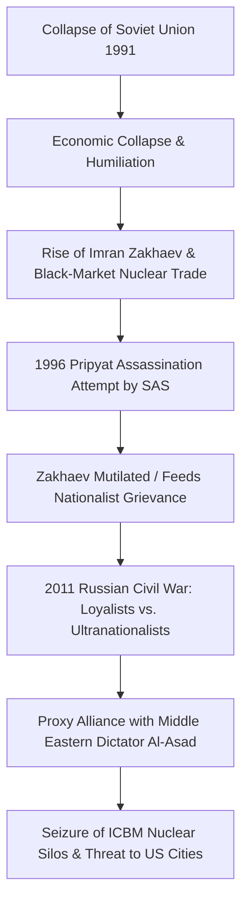

# 11. Political Ideology, Geopolitics & Neocolonial Discourse

## 1. Introduction: The Post-9/11 Imaginary
*Call of Duty 4: Modern Warfare* (2007) was released at the absolute zenith of the global War on Terror—four years after the US-led invasion of Iraq (2003) and six years after the invasion of Afghanistan (2001). During this historical juncture, Western popular culture was saturated with news imagery of urban counter-insurgency, improvised explosive devices (IEDs), televised executions of hostages, and pervasive anxieties regarding weapons of mass destruction (WMDs) falling into the hands of non-state actors or rogue states (Payne, 2016; Gagnon, 2010).

While Infinity Ward repeatedly asserted that *Modern Warfare’s* plot was purely fictional (McCandlish & Boon, 2008; Shacknews, 2007), the game functioned as a profound cultural mirror. It synthesized the two primary geopolitical anxieties of modern Anglo-American foreign policy into a single apocalyptic threat:
1. **The Post-Cold War Nightmare:** A nuclear-armed, revanchist Russian Ultranationalist faction seeking to restore the Soviet empire.
2. **The Post-9/11 War on Terror Nightmare:** An anti-Western, revolutionary coup in an oil-rich Middle Eastern nation executed by a charismatic Islamic demagogue.

---

## 2. Russian Ultranationalism: Revanchism, Grievance, and Nuclear Terror
The depiction of the Russian conflict in *Call of Duty 4* is rooted in the geopolitical trauma of the 1991 Soviet collapse. Imran Zakhaev is not constructed as a conventional communist, but as a dangerous hybrid: a Soviet military veteran who accumulated vast private wealth as a post-Soviet black-market arms dealer, subsequently founding the **Russian Ultranationalist Party**.

### Key Dimensions of the Ultranationalist Portrayal:
- **Imperial Nostalgia & Grievance:** Zakhaev’s rhetoric taps directly into genuine historical Russian grievances regarding NATO expansion, the loss of superpower status, and Western economic exploitation during the 1990s. In campaign briefings, Zakhaev rails against the *"corruption of the West"* and promises to *"restore the motherland to its rightful place."*
- **The Proxy Diversion:** Zakhaev exhibits sophisticated strategic cunning. Recognizing that a direct Russian confrontation with NATO would lead to annihilation, he finances and arms Khaled Al-Asad in the Middle East. The Middle Eastern coup is explicitly designed as a geopolitical diversion: while the American military commits its conventional armada into the desert sands, Zakhaev captures military installations and nuclear silos within the Russian Federation.
- **The Nuclear Climax:** The Ultranationalist threat culminates in the terrifying seizure of the Altay Mountains ICBM facility. By launching two nuclear missiles capable of killing 41 million American civilians, Zakhaev fulfills the ultimate Cold War terror scenario: catastrophic nuclear annihilation triggered by non-state extremist revanchism.

---

## 3. The Middle East: Orientalism, Chaos, and the Erasure of Sovereignty
The representation of the Middle East in *Call of Duty 4* provides textbook empirical evidence of **Edward Said’s Orientalism** remediated into an interactive 3D game engine (Höglund, 2008; Šisler, 2008).

### A. The Nameless Battleground
The Middle Eastern country at the center of the conflict is never given a name. It is identified in briefings merely as *"A Small, Oil-Rich Country in the Middle East."* This geographical erasure is ideologically profound:
- It strips the nation of specific historical, cultural, linguistic, and political identity.
- It homogenizes the entire Middle East into an undifferentiated landscape of dust, palm trees, Islamic calligraphy, concrete rubble, and armed fanatics.
- It permits the player to view the territory not as a sovereign community with domestic civilian life, but purely as an operational "target space" (Ramsay, 2015, 2020).

### B. The Construction of Khaled Al-Asad
Khaled Al-Asad is constructed through every recognizable Western media trope of the Middle Eastern dictator:
- He is bombastic, cruel, and performative, staging the execution of President Al-Fulani on live international television.
- He wields a gold-plated Desert Eagle, signifying corrupt third-world ostentation.
- Crucially, the narrative reveals that Al-Asad possesses zero authentic geopolitical sovereignty. He is not a genuine geopolitical peer, but merely a disposable pawn of Imran Zakhaev. Once his utility as a diversion ends, he flees his own burning capital and cowers in an isolated farm in Azerbaijan, where he is executed without trial.

### C. The Absolute Denial of Arab Agency (Parlak & Kaygusuz, 2025)
In their seminal study *Neocolonialism in Video Games: The Social Discourse of Call of Duty 4: Modern Warfare*, Cansu Parlak and Erdinç Kaygusuz deconstruct the profound inequality of agency between Western and non-Western subjects in the game:

| Subject Category | Playable Agency | Moral Representation | Ludic Function | Fate / Outcome |
|---|---|---|---|---|
| **Western Soldiers** (SAS / USMC) | Full ludic mastery (shooting, moving, breach, air strikes) | Rational, disciplined, heroic protectors of global order | Active agents who eliminate threats and solve crises | Survived or heroic sacrifice for comrades |
| **Middle Eastern Combatants** (OpFor) | None (AI enemy bots) | Fanatical, shouting, undifferentiated, disposable | Cannon fodder to be suppressed and eliminated | Mass slaughter by Western weapons |
| **Middle Eastern Politician** (Al-Fulani) | Severely constrained (Head swivel only; no movement) | Weak, corrupted, helpless victim of regional chaos | Passive spectacle of violence to justify US invasion | Executed point-blank on live television |

As Parlak and Kaygusuz argue, by making President Al-Fulani the *only* playable Middle Eastern character, yet completely stripping him of movement, speech, and weapon manipulation, the game structurally encodes the idea that the Middle East is fundamentally incapable of self-determination. The Middle Eastern subject can only be an executed victim or an armed fanatic; peace and order can only be restored through the benevolent, armed intervention of Western military force.

---

## 4. Western Intervention: Pre-Emption, Legitimacy, and Virtuous War
*Call of Duty 4* operationalizes the foundational doctrines of post-9/11 Western security policy:

### A. The Bush Doctrine of Pre-Emptive Strike
The narrative logic of the game is governed entirely by the doctrine of **pre-emption**. Western intelligence does not wait for international consensus, UN resolutions, or legal declarations of war:
- The British SAS invades an unflagged cargo ship in international waters on unverified contraband rumors (*Crew Expendable*).
- The US Marine Corps launches a massive amphibious and airborne invasion of a sovereign foreign capital within 24 hours of a domestic coup (*Charlie Don't Surf*).
- Captain Price conducts an extrajudicial targeted assassination of a Russian citizen on Ukrainian soil (*All Ghillied Up*).
- Price executes Khaled Al-Asad without trial or legal interrogation (*Safehouse*).

In every instance, the narrative constructs these violations of international law as absolutely necessary and morally unimpeachable. The imminent existential threat of nuclear devastation retroactively justifies every extrajudicial execution, cross-border violation, and black operation.

### B. The Dichotomy of the British SAS and US Marines
The game constructs two distinct national archetypes of Western military virtue:
1. **The American Marines (Mass, Force, Hubris):** The USMC represents the conventional military might of the United States. They arrive in massive helicopter formations with heavy armor, blasting rock music, shouting aggressive commands, and seeking decisive combined-arms victory. However, this conventional might proves hubristic: they are drawn into an urban quagmire and annihilated by an asymmetric nuclear device.
2. **The British SAS (Surgical Precision, Realism, Covert Mastery):** The SAS represents the post-imperial ideal of special-forces tradecraft. Operating in small four-man teams, moving through shadows, cutting power grids, and speaking in calm, understated professional banter, the SAS are the true saviors of the world. They succeed where the massive American army fails because they understand that modern warfare is fought in the dark through clandestine violence.

---

## 5. The Ethical Paradox: Critique of War or Militarist Apologia?
Does *Call of Duty 4: Modern Warfare* function as a critical anti-war text, or does it merely reinforce the ideological assumptions of the military-entertainment complex?

Scholarly consensus identifies a profound **ethical tension**:
- **The Case for Subversion (Robinson, 2012):** The campaign contains moments of profound anti-triumphalism. The sudden nuclear annihilation of Sergeant Paul Jackson in *Shock and Awe* and his slow, agonizing death in *Aftermath* systematically shatter the invulnerable power fantasy of mainstream action media. Furthermore, *Death From Above* deliberately provokes moral unease by exposing the chilling, video-game-like detachment of remote aerial killing. Finally, the tragic deaths of Gaz and Griggs and the cynical Russian media cover-up at the conclusion of *Game Over* deny the player a triumphant parade, leaving the world drenched in secret blood and political deceit.
- **The Case for Hegemonic Reproduction (Payne, 2016; Parlak & Kaygusuz, 2025; Stahl, 2010):** Despite these moments of tragedy, the game’s procedural rhetoric overwhelmingly affirms the necessity of Western militarism. The nuclear catastrophe does not lead the player to question *why* the US invaded the Middle East; it merely proves that the enemy was even more monstrous and dangerous than initially assumed. The horror of the nuclear blast ultimately serves to validate Captain Price’s ruthless, extrajudicial manhunt for Zakhaev. 

Ultimately, *Call of Duty 4* achieves something far more culturally enduring than crude state propaganda: **it creates an emotionally complex, self-critical military fantasy that absorbs anti-war sentiment (the tragedy of nuclear horror and dying soldiers) only to re-deploy that trauma as the ultimate justification for perpetual, covert special-forces warfare.**
