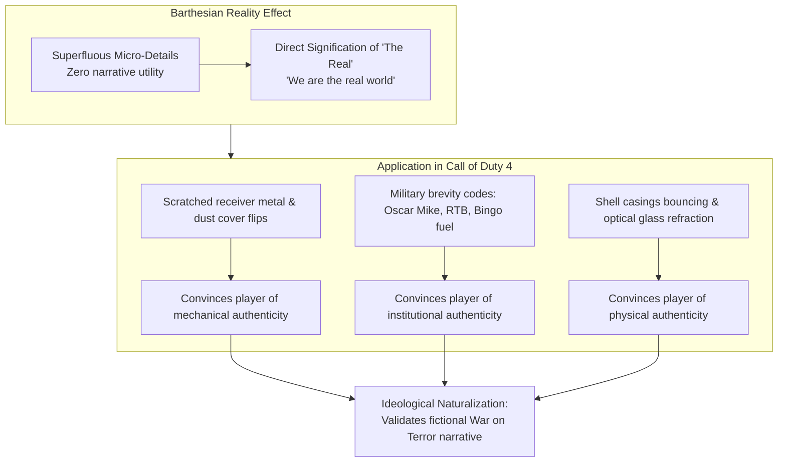
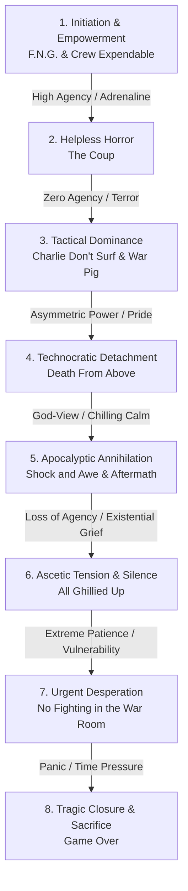

# 12. Realism, Semiotic Authenticity & Player Affective Experience

## 1. The Construction of Military Realism: The Reality Effect
A central paradox of *Call of Duty 4: Modern Warfare* is that while its campaign depicts an entirely fictional third world war narrowly averted—involving a Middle Eastern nuclear detonation, the seizure of Russian ICBM silos, and extrajudicial black operations—players and contemporary critics widely hailed it as the most "realistic" military game ever created.

To understand this phenomenon, we turn to French semiotician Roland Barthes’ (1968/1986) seminal concept of the **"Reality Effect" (*l'effet de réel*)**, rigorously applied to *Call of Duty 4* by Kha Dung Cao (2024).

### Superfluous Realism as Ideological Persuasion (Cao, 2024)
Barthes observed that in 19th-century realist literature, authors introduced minute descriptive items that had no plot function (such as the barometer in Flaubert’s *A Simple Heart*). These details exist solely to produce a semiotic aura of the real.

Cao (2024) demonstrates that *Modern Warfare* is saturated with Barthesian reality effects:
1. **Mechanical Tactility:** During reloads, the player's avatar doesn't merely swap a magazine; their fingers flick the dust cover closed on an M4, hit the bolt release with the heel of the palm, or tug on the charging handle of an AK-47. Scratches on the phosphate coating of weapon receivers and worn paint on rifle barrels convey a history of field use.
2. **Acoustic Jargon:** The audio track is continuously punctuated by authentic military jargon and brevity codes: *"Oscar Mike"* (on the move), *"Check your six"*, *"Flash out"*, *"Tango down"*, *"Bingo fuel"*, *"Clear left, clear right"*. These terms communicate negligible narrative information, but their constant repetition envelops the player in a persuasive illusion of professional soldierly belonging.
3. **Environmental Detritus:** Levels are littered with functionally inert physical artifacts: discarded Soviet propaganda posters in Pripyat, burned-out civilian Lada sedans in the Caucasus, shattered porcelain sinks in Azerbaijani farmhouses, and fluttering Arabic newspapers blown across dusty roads in the Middle East.

These micro-details convince the player that the game world is physically and historically authentic. Consequently, the player lowers their critical defenses, unconsciously accepting the game’s deeply ideological, neocolonial narrative framing of contemporary geopolitics as equally "real" (Cao, 2024; Payne, 2016).

---

## 2. Selective Realism: The Systematic Filtering of War's Trauma
While *Call of Duty 4* achieves staggering realism in tactical weapon manipulation and audio rendering, it operates through what Holger Pötzsch (2015, 2017) designates as **"selective realism."**

The game hyper-realizes the *pleasurable, kinetic aspects of warfare* while systematically filtering out its *human, structural, and ethical costs*:

| Realistic Domain (Hyper-Realized) | Sanitized Domain (Systematically Filtered Out) | Ideological & Ludic Consequence |
|---|---|---|
| **Weapon Recoil & Ballistics** (Recoil climb, muzzle climb, bullet penetration) | **Visceral Wound Trauma** (No dismemberment from small arms; bodies cleanly ragdoll and disappear) | War is presented as clean, athletic, and surgical rather than grotesque and mutilating. |
| **Tactical Breaching** (Flashbang blind effects, coordinated dynamic room clears) | **Civilian Non-Combatants** (Apartment blocks and city streets are completely emptied of non-combatant families) | Urban spaces are framed purely as enemy kill zones, erasing the reality of civilian collateral slaughter. |
| **Close Air Support** (AC-130 105mm artillery, Cobra Hellfire strikes) | **Long-Term Structural Devastation** (Destruction of water grids, hospitals, generational displacement) | Air strikes appear as instantaneous, satisfying tactical solutions rather than engines of generational humanitarian crises. |
| **Instant Respawn & Regeneration** (Red-screen breathing reset after 4 seconds behind cover) | **Prolonged Medical & Psychological Trauma** (Zero depiction of permanent limb loss, PTSD, or veteran agony) | Insulates the player from the permanent physical and psychological consequences of combat. |
| **Institutional Rules of Engagement** ("Friendly fire will not be tolerated!" system reset) | **Authentic Ethical Deliberation** (No moral branching, no judicial consequences, no war crimes investigation) | Replaces genuine moral conscience with automated cybernetic enforcement (Schulzke, 2013). |

---

## 3. Audiovisual Design, Music & Spatial Acoustics
The auditory landscape of *Call of Duty 4*—overseen by Audio Director Mark Grigsby and composer Stephen Barton, with theme music composed by Harry Gregson-Williams—played a decisive role in redefining video game realism:

### A. Dynamic Weapon Audio & Acoustic Reverberation
Prior to 2007, video game gunshots were static, single-channel sound files played on loop. Infinity Ward engineered an adaptive sound engine that modulated weapon audio based on environmental geometry:
- **Indoor vs. Outdoor Reflection:** Firing an M4 inside a tiled bathroom in *The Bog* produces sharp, deafening, metallic slap-back echoes. Firing the same weapon across an open cornfield in *Hunted* produces a sharp crack followed by low-frequency acoustic roll-off.
- **Distance Attenuation & Ballistic Cracks:** The sound of incoming enemy fire separates the supersonic crack of the passing bullet from the delayed, low-frequency boom of the muzzle discharge, training the player to aurally estimate enemy distance and azimuth.

### B. The Sound of Trauma: The Tinnitus Filter
In moments of extreme physical shock—the cargo ship boiler explosion in *Crew Expendable*, the aftermath of the nuclear blast in *Aftermath*, and the bridge collapse in *Game Over*—the audio engine suddenly cuts all ambient sound, music, and dialogue, replacing it with a high-pitched, ringing sine wave (simulating acoustic ear trauma/tinnitus) accompanied by the slow, muffled thudding of the player's heartbeat. This acoustic device strips the player of sensory equilibrium, viscerally communicating concussive bodily trauma.

### C. The Gregson-Williams & Barton Musical Score
The musical score eschews traditional orchestral brass fanfares in favor of a hybrid industrial-electronic and orchestral palette:
- Middle Eastern combat tracks incorporate distorted Arabic strings (oud), heavy synthetic bass pulses, and urgent percussion, heightening foreign otherness and kinetic danger.
- The Pripyat flashback (*All Ghillied Up*) uses minimalist, drone-heavy ambient synthesizers that evoke post-nuclear desolation and radioactive decay.
- *Game Over* culminates in a tragic, mournful string arrangement that emphasizes loss and sacrifice over triumphalist victory.

---

## 4. The Affective Trajectory: Mapping Player Psychology Across the Campaign
The single-player campaign of *Modern Warfare* is an affective rollercoaster designed to manipulate player emotion through carefully calibrated shifts in ludic agency:

### Phase-by-Phase Affective Deconstruction:
1. **Initiation & Empowerment (*F.N.G.* & *Crew Expendable*):** Establishes the pleasure of somatic competence. The player experiences the intoxicating thrill of mastering weapon recoil, clearing rooms with precision, and earning the gruff respect of Captain Price.
2. **Helpless Horror (*The Coup*):** The player’s power fantasy is brutally severed. Bound inside a car as President Al-Fulani, the player experiences sensory disorientation, humiliation, and dread, culminating in the shocking trauma of point-blank execution.
3. **Tactical Dominance (*Charlie Don't Surf* & *War Pig*):** Restores high-octane agency through the perspective of the US Marines. The player feels protected by heavy armor, air strikes, and roaring combined-arms firepower.
4. **Technocratic Detachment (*Death From Above*):** The player is elevated to a god-like vantage point. The emotional state shifts from adrenaline-fueled fear to cold, dispassionate amusement, transforming human slaughter into clean digital target practice.
5. **Apocalyptic Annihilation (*Shock and Awe* & *Aftermath*):** The ultimate psychological trauma of the campaign. The nuclear blast obliterates the player's heroic rescue mission. In *Aftermath*, the player endures several agonizing minutes of sensory degradation, dragging a dying soldier through nuclear fallout until his heart flatlines.
6. **Ascetic Tension & Silence (*All Ghillied Up*):** In Pripyat, emotional tension is generated not through shooting, but through absolute physical restraint. The player experiences suffocating paranoia, holding their breath while lying prone inches from enemy boots.
7. **Urgent Desperation (*No Fighting in the War Room*):** An 8-minute countdown timer provokes intense cognitive stress and spatial panic as the player fights through subterranean corridors to prevent global nuclear annihilation.
8. **Tragic Closure & Sacrifice (*Game Over*):** The final highway bridge collapse strips away tactical options. Watching Gaz and Griggs murdered while concussed triggers feelings of intense grief and rage, culminating in the visceral, slow-motion catharsis of shooting Imran Zakhaev with Price's M1911 pistol. The quiet, tragic ending leaves the player with a profound sense of exhaustion and melancholy.

