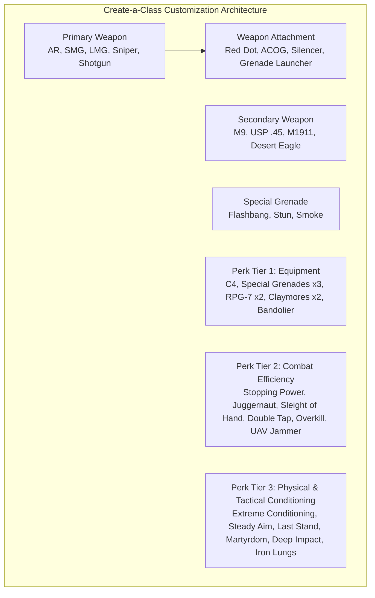
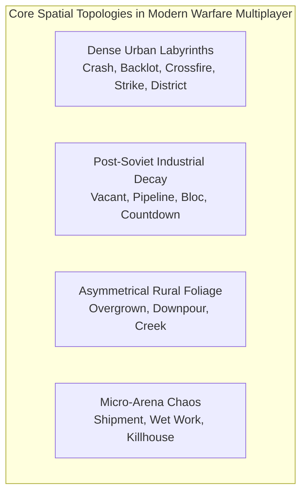
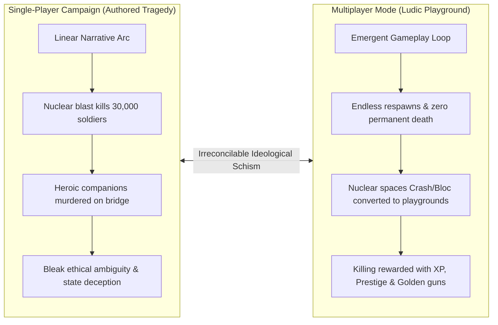

# 13. Multiplayer Systems & The Competitive Reconstruction of Warfare

## 1. Introduction: The Twin Engines of *Modern Warfare*
While *Call of Duty 4: Modern Warfare* achieved critical acclaim for its cinematic, multi-perspective single-player campaign, its multiplayer component fundamentally revolutionized the commercial landscape of console and PC gaming. It established the mechanical and structural template that dominated online first-person shooters for the subsequent two decades: persistent progression loops, customizable loadouts, emergent perk synergies, and performance-based killstreak rewards (Payne, 2016; Huntemann & Payne, 2010).

Crucially, the relationship between the single-player campaign and the multiplayer mode embodies a profound **ludonarrative tension**:
- The **campaign** is an authored, highly tragic, linear narrative that deconstructs the limits of military intervention, culminating in the nuclear deaths of thirty thousand soldiers, the execution of squad comrades, and the cynical political concealment of truth.
- The **multiplayer**, conversely, extracts the identical weapons, character avatars, uniforms, and war-torn environments, stripping them of all ethical gravity and political consequence, transmuting geopolitical catastrophe into an endlessly repeatable, dopamine-driven competitive sports arena.

---

## 2. The Create-a-Class System & Tactical Specialization
Introduced as an unlockable feature at Level 4, the **Create-a-Class** system dismantled the rigid, pre-set class structures of earlier shooters (such as *Battlefield* or *Team Fortress*), granting players unprecedented agency in assembling custom combat kits:

### The Three-Tier Perk Economy:
- **Perk 1 (Equipment & Munitions):** Determined initial tactical inventory. Choices included extra ammunition (*Bandolier*), deployable anti-personnel traps (*Claymores ×2*), or heavy explosives (*C4 ×2*, *RPG-7 ×2*).
- **Perk 2 (Lethality vs. Survivability):** The philosophical heart of class tuning. Players faced an agonizing zero-sum choice between increasing weapon damage output (*Stopping Power*), expanding player health pools (*Juggernaut*), cutting reload times by 50% (*Sleight of Hand*), or disappearing from enemy radar sweeps (*UAV Jammer*).
- **Perk 3 (Mobility, Precision & Spite):** Altered bodily mechanics. Included extended sprint endurance (*Extreme Conditioning*), enhanced hip-fire accuracy (*Steady Aim*), wall-penetration amplification (*Deep Impact*), or controversial death-triggered mechanics (*Martyrdom*—dropping a live frag grenade upon death; *Last Stand*—pulling a pistol while dying on the floor).

---

## 3. The Killstreak Reward System: Automating Virtuous War
*Call of Duty 4* was the first mainstream multiplayer game to reward players with automated military assets for consecutive, deathless kills:

| Streak Requirement | Asset Unlocked | Operational Mechanics | Ideological & Ludic Function |
|---|---|---|---|
| **3 Kills** | **UAV (Reconnaissance)** | Sweeps the minimap every 3 seconds for 30 seconds, revealing the exact coordinates and facing vectors of all non-jammed enemy players. | Institutional surveillance: renders the enemy transparent, transforming knowledge into asymmetric lethality. |
| **5 Kills** | **Airstrike** | The player opens a handheld tactical map and designates a vector; three delta-wing fighter-bombers carpet-bomb the target line with high explosives. | Remote standoff destruction: eliminates players behind cover without risk to the caller. |
| **7 Kills** | **Attack Helicopter** | An AI-controlled attack helicopter (AH-1W Cobra for Coalition; Mi-24 Hind for OpFor) enters the airspace, independently tracking and eliminating exposed enemy players with autocannons and rockets. | Delegated autonomous violence: the player summons an algorithmic executioner that dominates the airspace. |

### The Compounding Momentum Loop
The killstreak system fundamentally altered multiplayer psychology. In earlier games, dying was an inconsequential reset. In *Call of Duty 4*, dying reset the player’s killstreak counter to zero, generating intense psychological stakes for every single combat encounter. 

Furthermore, kills achieved via the Airstrike or Attack Helicopter counted directly toward the *next* killstreak in a compounding cascade. This introduced the **"snowball effect"**: skilled players who secured early kills could establish absolute, inescapable dominance over the map through rolling aerial bombardments, mirroring the asymmetric dominance of Western air power over ground forces in contemporary military doctrine (Der Derian, 2009; Payne, 2016).

---

## 4. Progression, Prestige & The Commodification of Military Identity
The game introduced a persistent **Experience Point (XP) and Prestige** system that transformed multiplayer gaming into a digital treadmill of continuous gratification:
- **Leveling Curve (Levels 1–55):** Every match awarded XP for kills, assists, objective captures, and completed weapon challenges (e.g., 150 headshots with an AK-47). Levels unlocked new weapons, attachments, perks, and camouflage skins (culminating in the coveted Golden weapon finishes).
- **The Prestige Mode:** Upon reaching Level 55 (General), players were presented with a radical choice: remain at max rank with all equipment unlocked, or enter **Prestige Mode**—voluntarily resetting all weapons, challenges, and perks back to Level 1 in exchange for a unique medal icon next to their gamertag. This cycle could be repeated ten times.

### Psychological & Cultural Analysis:
As Matthew Thomas Payne (2016) observes, Prestige Mode represents the ultimate commodification of military rank. Real-world military promotion is bound to institutional service, tactical leadership, and sacrifice. In *Call of Duty 4*, military rank is abstracted into an endless consumer loop of prestige, where social status within the gaming community is measured purely by the volume of hours invested in executing digital violence.

---

## 5. Architectural Deconstruction of Multiplayer Map Design

The sixteen launch maps of *Call of Duty 4* (complemented by four *Variety Map Pack* additions) were direct geographical remediations of single-player campaign assets:

| Map Name | Campaign Origin & Environment | Tactical Design & Sightline Architecture | Chokepoints & Verticality |
|---|---|---|---|
| **Crash** | Downed Sea Knight in Middle Eastern town (*Shock and Awe*) | Circular 3-lane design centered on the downed helicopter; high vertical rooftops (three-story building, blue building). | Roof snipers dominate center; tight alleyway flanking routes reward SMG and shotgun breaches. |
| **Crossfire** | Deserted Middle Eastern avenue (*War Pig*) | Dominant central downhill sniper corridor flanked by two-story concrete apartments, laundromats, and shops. | Severe sniper battles down the main street; interior CQB flank routes through damaged apartments. |
| **Overgrown** | Ukrainian rural farmland (*Hunted*) | Expansive open environment with a central dry riverbed, overgrown cornfields, grandma’s house, and gas station. | Long-distance sniper duels across the riverbed; ghillie suit concealment in tall weeds. |
| **Shipment** | Bering Strait cargo containers (*Crew Expendable*) | Symmetrical micro-arena composed of crossing shipping containers in a tiny square lot. | Instant, chaotic spawns; non-stop grenade spam; matches average hundreds of deaths in minutes. |
| **Vacant** | Abandoned Russian office complex (*Blackout*) | Mix of claustrophobic interior tiled corridors and an open exterior shipping yard. | Extreme chokepoints at the central hallway; shotgun and SMG dominance indoors; assault rifle dominance outside. |
| **Backlot** | Middle Eastern construction zone (*The Bog*) | Central unfinished three-story building surrounded by ruined housing blocks and parking lots. | Vertical dominance from the central construction site; high grenade and RPG angles. |
| **Bloc** | Soviet housing tenements in Pripyat (*All Ghillied Up*) | Two massive, symmetrical multi-story apartment complexes separated by a central courtyard with a statue. | Classic sniper corridor across the courtyard; claustrophobic interior stairwell brawls. |
| **Pipeline** | Russian railway depot and industrial facility (*Hunted*) | Two large warehouse buildings connected by underground drainage tunnels and an open train track yard. | High subterranean flanking risk; catwalk snipers overseeing the train cars. |

---

## 6. The 2016 Remastered Multiplayer: Preservation vs. Monetization
When Raven Software reconstructed the multiplayer mode for *Call of Duty: Modern Warfare Remastered* (2016), they faced immense commercial and community pressures (Pellas, 2016; Burnett, 2016):

### A. Technical & Gameplay Preservation
Raven meticulously maintained the original 2007 tick-rate, weapon recoil patterns, hip-fire spread coefficients, and movement velocity. The initial release shipped with **10 remastered maps** at launch, with the remaining **6 original maps** (plus the Christmas-themed *Winter Crash*) patched in for free in December 2016. The visual upgrade was profound: PBR textures transformed the concrete walls of Crash and the wet mud of Overgrown into tangible, hyper-detailed surfaces.

### B. The Rupture of Supply Drops & Microtransactions
Despite pre-launch assurances that the remaster would preserve the purity of the 2007 competitive experience, Activision and Raven Software introduced the **"Depot" supply drop system** in December 2016:
- **Loot Boxes & Customization:** Players could purchase or earn "Call of Duty Points" to unlock weapon camos, calling cards, emblems, character reticles, and new melee weapons (e.g., shovels, bayonets, sickles).
- **New Weaponry:** Crucially, the remaster introduced brand-new functional firearms that did not exist in the 2007 original: the Kamchatka 12 shotgun, the XM-LAR assault rifle, the BOS14, and the Mac-10 SMG.

This introduction provoked fierce backlash from historical purists, illustrating how 21st-century live-service monetization models inevitably erode and supersede historical software preservation (Newman, 2012).

---

## 7. The Ideological Tension: Authoring Tragedy vs. Consuming Warfare
The coexistence of *Call of Duty 4's* campaign and multiplayer exposes the ultimate ideological contradiction of contemporary military entertainment:

In the campaign, the detonation of a nuclear warhead in *Shock and Awe* is a tragedy that strips the player of all power and agency. In multiplayer, that same irradiated city center becomes **Crash**—a brightly lit arena where players sprint through the wreckage of the crashed helicopter, earn Airstrikes, and laugh with friends over voice chat while hunting for golden camouflage skins.

Multiplayer systematically purges the narrative of all ethical hesitation, geopolitical critique, and human suffering. It fulfills the ultimate promise of the military-entertainment complex: transforming the machinery and spaces of real-world destruction into a frictionless, monetized consumer spectacle (Stahl, 2010; Payne, 2016; Der Derian, 2009).
