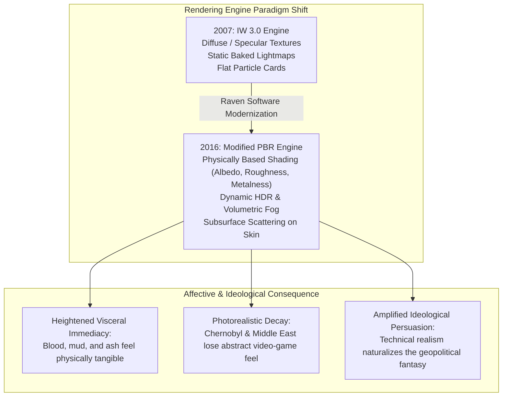

# 14. Modern Warfare Remastered (2016): Technical Reconstruction & Narrative Preservation

## 1. Production Context & The Remastering Mandate
In November 2016, Activision published *Call of Duty: Modern Warfare Remastered* (MWR), developed primarily by **Raven Software** with supplementary production support from **Beenox** and **Certain Affinity**, overseen by Infinity Ward executive leadership. Initially bundled exclusively as an incentive with the legacy editions of *Call of Duty: Infinite Warfare*, the release marked the ninth-generation console debut of the foundational 2007 classic on PlayStation 4, Xbox One, and PC.

Under the direction of Raven Software Studio Director David Pellas and Executive Producer Ryan Burnett, the development team was charged with an extraordinarily delicate mandate: **achieve contemporary eighth-generation visual and auditory fidelity while strictly preserving the mechanical feel, collision timing, and narrative integrity of the 2007 original** (Pellas, 2016; Burnett, 2016).

---

## 2. Mandatory Comparative Matrix: 2007 Original vs. 2016 Remaster

| Dimension | 2007 Original (*Call of Duty 4*) | 2016 Remaster (*Modern Warfare Remastered*) | Critical & Semiotic Significance |
|---|---|---|---|
| **Development Studio** | Infinity Ward (Lead: Jason West, Vince Zampella) | Raven Software (Lead: David Pellas, Ryan Burnett) with Beenox | Shift from original auteur creation to reverent archaeological reconstruction. |
| **Game Engine Pipeline** | Proprietary IW 3.0 Engine (DirectX 9 / Seventh-Gen) | Heavily modified Advanced Warfare / Infinite Warfare engine branch | Transition from legacy forward-rendering to modern deferred rendering. |
| **Material & Shading Model** | Traditional diffuse, specular, and bump mapping | Full **Physically Based Rendering (PBR)** pipeline | Surfaces accurately absorb and reflect light based on real-world roughness and metallicity. |
| **Lighting Architecture** | Baked static lightmaps with rudimentary dynamic point lights | Real-time **High Dynamic Range (HDR)** lighting, dynamic shadows | Drastically enhances atmospheric contrast between deep shadows and blinding flares. |
| **Atmospheric Effects** | 2D particle billboards; flat alpha-blended smoke sheets | Volumetric smoke, 3D dynamic fog, physical fire propagation | Dust, steam, and explosion smoke possess physical density, altering tactical sightlines. |
| **Geometry & Polygon Density** | Low-poly character silhouettes (~3,000–5,000 polygons/model) | High-poly rebuilt assets (~30,000–50,000+ polygons/model) | Eliminates blocky edges on weapons, vehicles, and character uniforms. |
| **Facial & Body Animation** | Rigid, keyframed facial bones; repetitive lip-sync | High-resolution facial motion capture; realistic eyes, pores, sweat | Imbues Price, Gaz, and Al-Asad with nuanced micro-expressions of grief and fury. |
| **First-Person Viewmodel** | Floating hands detached from visible player lower body | Modeled legs, boots, and torso visible when looking down; realistic shadows | Deepens somatic embodiment: the player exists as a physical body in the virtual space. |
| **Weapon Animations** | Snappy, utilitarian 2007 reload cycles | Re-animated tactical reloads; weapon inspection animations; subtle idle sways | Amplifies tactile satisfaction and mechanical gun-porn fetishization. |
| **Foliage & Environment** | Flat, intersecting grass planes; static trees | Dynamic procedural foliage reacting to wind, player crawling, and explosions | *All Ghillied Up* transforms into an extraordinarily dense, photorealistic wilderness. |
| **Acoustic Architecture** | Compressed stereo/5.1 audio; generic stock weapon samples | Uncompressed, multi-channel spatial audio; re-recorded field Foley | Weapon reports possess devastating low-end bass punch and distinct environmental slap-back. |
| **Voice Performances** | Original iconic voice cast (Billy Murray, Craig Fairbrass, Mark Grigsby) | Original vocal recordings completely preserved and digitally remastered | Ensures absolute narrative identity; zero dialogue re-recordings or script alterations. |
| **Gameplay Tick-Rate & Timing** | 60 Hz physics update; specific sprint and jump curves | 100% mechanical parity; identical acceleration, mantle, and weapon recoil values | Preserves the muscle-memory and tactical cadence of veteran competitive players. |
| **Collision Geometry** | Invisible box brushes defining level boundaries | Re-mapped exact collision geometry overlaid onto complex visual meshes | Guarantees that grenade bounce angles and bullet-penetration walls behave identically. |
| **Multiplayer Economy** | Pure linear XP progression (Levels 1–55; 10 Prestiges); zero DLC microtransactions | Original progression preserved, but augmented with the "Depot" loot box economy and new weapons | Commercial rupture: injects live-service monetization into a historical preservation project. |

---

## 3. Visual & Aesthetic Remediation: From Abstraction to Physicality

### A. Physically Based Rendering (PBR) and Materiality
In the 2007 original, materials were represented through flat textures with artificial specular shine applied across all surfaces. In the 2016 remaster, Raven Software rebuilt every asset from scratch using PBR shaders:
- **Weapons:** The receiver of the M4A1 exhibits micro-abrasions, authentic matte black phosphate coating, and distinct light refraction across aluminum Picatinny rails. Scratches reveal bare silver steel beneath worn paint.
- **Uniforms:** The wool threading of Captain Price’s boonie hat, the rip-stop nylon of Gaz’s tactical vest, and the heavy ballistic Kevlar of Jackson’s IBA vest absorb and scatter light with photorealistic authenticity.
- **Environments:** Mud in the Azerbaijani hills (*Safehouse*) glistens with wetness, while dry, chalky concrete in the Middle Eastern streets (*Charlie Don't Surf*) reflects harsh desert sunlight with intense, blinding glare.

### B. Dynamic Lighting, Volumetric Atmosphere & HDR
The implementation of dynamic High Dynamic Range (HDR) lighting transforms the atmospheric tone of the campaign:
- In *Crew Expendable*, lightning strikes illuminate the pitch-black Bering Strait, casting dynamic real-time shadows across rolling ocean swells and shining water droplets on the player’s weapon lens.
- In *The Coup*, when Al-Fulani is dragged from the dark interior of the transport into the blinding midday desert sun, the HDR exposure mimics the human iris, temporarily blinding the player with overexposed white light before slowly revealing the execution courtyard.
- In *Shock and Awe*, the nuclear detonation is rendered with volumetric fluid dynamics: the rising mushroom cloud billows with incandescent heat, illuminating towering dust plumes and casting ominous, moving shadows across the disintegrating city.

---

## 4. Somatic Embodiment & Animation Refinement
A subtle yet profound change in the remaster is the re-engineering of the player's physical avatar:
- **First-Person Lower Body Modeling:** In the 2007 original, the player was a disembodied camera with floating arms; looking down revealed empty space. In MWR, tilting the camera downward reveals Soap’s or Jackson’s legs, boots, and tactical holsters. When sprinting, crouching, or crawling prone, the player’s legs kick and slide across the terrain in sync with player movement.
- **Tactical Reloads & Weapon Inspections:** Raven added contextual reload animations that vary based on whether a round remains chambered (tactical reload) or the weapon is completely empty (dry reload). Furthermore, holding the weapon-switch button allows the player to perform an idle weapon inspection, turning the firearm to admire its mechanical components and finish. This addition deepens what game scholars identify as "gun-porn"—the fetishistic celebration of lethal military technology (Payne, 2016).
- **Subsurface Scattering on Character Models:** In 2007, character faces appeared somewhat waxy and rigid under direct light. The remaster incorporates subsurface scattering, simulating how light penetrates human skin. This imparts remarkable emotional expressiveness to Price’s weather-beaten face, Gaz’s determined eyes, and Viktor Zakhaev’s panicked sweat during the rooftop confrontation.

---

## 5. Acoustic Engineering & Spatial Re-Recording
While the original voice acting performances were preserved without alteration, the entire soundscape was reconstructed from the ground up:
- **Authentic Firearm Field Recordings:** Raven Software captured fresh audio from real military firearms fired in open fields, indoor concrete rooms, and underground tunnels. The resulting gunshot audio possesses devastating transient impact and sub-bass resonance, making the 2007 weapons sound thin and compressed by comparison.
- **3D Positional Spatial Audio:** Using object-based spatial audio mixing, incoming bullets, shouting enemies, and rotor blades are positioned with pinpoint geometric precision, heightening situational awareness and auditory immersion.
- **Environmental Foley:** The sound of crunching autumn leaves in *Overgrown*, metallic footsteps on rusted catwalks in *Pipeline*, and the eerie, metallic groaning of Pripyat’s abandoned ferris wheel in *One Shot, One Kill* were re-recorded in ultra-high-definition, transforming ambient environments into rich acoustic landscapes.

---

## 6. The Preservation Paradox: Reconstructing Historical Memory
The central theoretical challenge posed by *Modern Warfare Remastered* concerns **video game preservation and cultural memory** (Newman, 2012).

### The "Nostalgia Shader"
When players played *Modern Warfare Remastered* in 2016, a frequent critical reaction was: *"This doesn't look like a new game; this is exactly how I remember it looking in 2007."* 

As Studio Director David Pellas explicitly noted (2016), human memory naturally idealizes the visual fidelity of past media experiences. The 2007 original, when viewed on modern 4K displays, reveals its severe seventh-generation technical constraints: flat textures, jagged low-poly edges, static lighting, and compressed audio. Raven Software’s achievement was not merely technical modernization, but the **engineering of memory**: they rebuilt the game to match the player’s idealized nostalgic recollection of the classic, rather than its historical reality.

### The Ideological Amplification of Remastered Fidelity
Does upgrading a game's graphics change its political meaning? In *Call of Duty 4*, the answer is a resounding yes:
1. **Intensified Immediacy:** By rendering the violence through photorealistic blood spatter, volumetric smoke, and tactile weapon physics, the remaster strips the 2007 conflict of its historical distance. The game no longer feels like a historical artifact of the early Bush-Blair War on Terror; it feels like an immediate, contemporary conflict happening right now.
2. **Naturalizing the Reality Effect:** As Kha Dung Cao (2024) argued, the ideological power of *Modern Warfare* resides in its Barthesian "Reality Effect." By dramatically multiplying the density of realistic micro-details—individual rust flakes on Soviet railings, authentic fabric creases on Marine uniforms, hyper-realistic dust motes floating in sunlight—the 2016 remaster makes the game's simplified, Western-centric geopolitical fantasy vastly more persuasive and seductively real to a modern audience.
