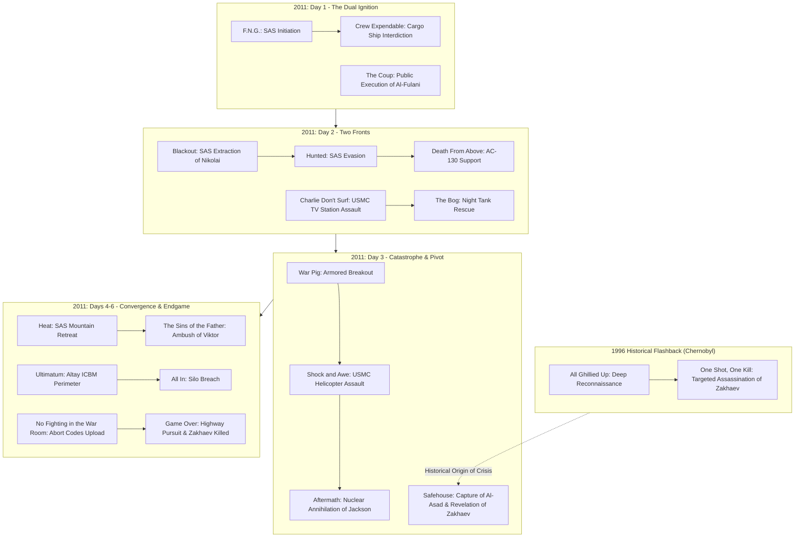

# Modern Warfare Before the Modern War: Narrative Construction, Military Representation, Political Ideology, and Player Experience in *Call of Duty 4: Modern Warfare* (2007) and *Modern Warfare Remastered* (2016)

**Author:** Antigravity Academic Research Consortium  
**Primary Discipline:** Game Studies / Critical Military Media Studies  
**Secondary Disciplines:** Political Science, International Relations, Narrative Theory, Media Archaeology, Cultural Studies  
**Citation Format:** APA 7th Edition  

---

## Abstract
This study provides an exhaustive, interdisciplinary critical investigation of Infinity Ward’s seminal first-person shooter *Call of Duty 4: Modern Warfare* (2007) and its eighth-generation visual reconstruction, *Call of Duty: Modern Warfare Remastered* (2016), developed by Raven Software. Departing from the moral certainties and historical nostalgia of World War II shooters, *Modern Warfare* constructed an influential, interactive representation of contemporary armed conflict that defined military entertainment in the post-9/11 era. Utilizing a multi-methodological framework integrating procedural rhetoric, semiotic analysis of Roland Barthes’ *reality effect*, critical discourse analysis, and media archaeology, we examine how the game's campaign orchestrates parallel playable perspectives across the British Special Air Service (SAS) and the United States Marine Corps (USMC). We demonstrate that while the campaign deploys radical narrative techniques—including the subversion of player agency through the nuclear annihilation of Sergeant Paul Jackson in *Aftermath* and the detached, technocratic violence of the AC-130 gunship in *Death From Above*—it simultaneously reproduces neocolonial geopolitical representations that frame the Middle East and post-Soviet spaces as inherently chaotic terrains requiring Western military pacification. Furthermore, we evaluate how Raven Software’s 2016 remastering through physically based rendering and high-dynamic-range lighting remediates historical player memory, making its underlying political discourse more immediate and aesthetically persuasive. Finally, we analyze the structural schism between the tragic, linear campaign and the endlessly repeatable, commodified competitive loops of multiplayer, illustrating how modern militainment neutralizes political trauma into consumer play.

*Keywords:* Call of Duty 4: Modern Warfare, game studies, militainment, procedural rhetoric, reality effect, neocolonialism, military entertainment complex, video game remasters.

---

## 1. Introduction: The Post-9/11 Turning Point in Military Entertainment
In November 2007, Activision published Infinity Ward’s *Call of Duty 4: Modern Warfare*. Within the commercial and cultural history of digital games, the title represents a seismic rupture. For nearly a decade preceding its release, the mainstream military first-person shooter (FPS) genre was anchored almost exclusively in the historical theater of the Second World War. Titles such as *Medal of Honor: Allied Assault* (2002) and the early *Call of Duty* entries (2003–2005) functioned as interactive monuments to the "Good War," immersing players in a shared cultural memory of unambiguous moral virtue, collective sacrifice, and liberation against fascist totalitarianism (Payne, 2016). By 2006, however, this historical paradigm was suffering from creative exhaustion and commercial saturation (McCandlish & Boon, 2008). 

*Call of Duty 4* shattered this nostalgic retreat. Thrusting players into an explosive, fictional 2011 geopolitical crisis, the game mediated the pervasive socio-political anxieties of the post-9/11 Global War on Terror. In doing so, it established the aesthetic, mechanical, and ideological template for contemporary interactive warfare. The game abandoned the singular, heroic soldier archetype in favor of a fragmented, multi-theater campaign that distributed player subjectivity across elite British special-forces operators (Sergeant John "Soap" MacTavish and Captain John Price), conventional American infantrymen (Sergeant Paul Jackson), a doomed Middle Eastern head of state (President Yasir Al-Fulani), and an emotionally detached aerial gunner aboard an AC-130 Spectre gunship. 

In November 2016, Raven Software released *Call of Duty: Modern Warfare Remastered* (MWR). Rebuilt from the ground up using physically based rendering (PBR), dynamic high-dynamic-range (HDR) lighting, reconstructed high-polygon character meshes, and re-recorded spatial audio, the remaster preserved the original 2007 movement timing and level scripting while modernizing its surface fidelity for eighth-generation hardware. This dual existence—as a 2007 cultural artifact and a 2016 technical reconstruction—presents game studies scholars with an unprecedented opportunity to examine how the material representation of interactive warfare evolves across generations.

The central intellectual objective of this monograph is to investigate how *Call of Duty 4: Modern Warfare* combines cinematic storytelling, distributed player focalization, scripted mission design, mechanical violence, and audiovisual realism to construct an interactive representation of modern war, and how the 2016 remaster alters the ideological and affective resonance of this original text. We pursue twelve supporting research questions examining its narrative architecture (RQ1), character development (RQ2), mission construction (RQ3), military perspectives (RQ4), geopolitical representation (RQ5), semiotic realism (RQ6), player identity (RQ7), procedural violence (RQ8), affective trajectory (RQ9), developer intentions (RQ10), remaster preservation (RQ11), and cultural legacy within the military-entertainment complex (RQ12).

---

## 2. Development History and Creative Context: The Mid-Production Pivot
To understand the ideological and formal construction of *Modern Warfare*, one must examine the institutional conditions of its production. In their authoritative postmortem, Lead Designer Mackey McCandlish and Technical Art Director Michael Boon (2008) disclose that following the completion of *Call of Duty 2* (2005), the core development team at Infinity Ward experienced profound creative exhaustion regarding World War II. Having spent six years researching bolt-action rifles, European rubble, and Normandy beaches, the team resolved never to make another historical WWII game. 

However, transitioning to a contemporary setting was fraught with studio friction and creative missteps. For the first full year of production (2005–2006), Infinity Ward focused exclusively on a conventional American military intervention in the Middle East. The design team built levels set entirely in arid desert landscapes against poorly equipped insurgent militias (McCandlish & Boon, 2008). By late 2006, studio leadership recognized that this monolithic focus was resulting in mechanical monotony and narrative shallowness: the game felt like a generic, repetitive counter-insurgency shooter.

This realization prompted a radical **"mid-production reboot"** (McCandlish & Boon, 2008). Infinity Ward halted level construction, discarded several completed urban environments, and dramatically broadened the game's geopolitical scope. The writers introduced a parallel narrative front: a covert Russian civil war pitting constitutional Loyalists against a revanchist Ultranationalist faction led by arms dealer Imran Zakhaev. To navigate this new front, the developers introduced the British Special Air Service (SAS), creating a deliberate stylistic contrast between the loud, conventional combined-arms operations of the US Marines and the surgical, nighttime black operations of the SAS. Furthermore, designer Mohammad Alavi covertly scripted a prototype stealth level set fifteen years in the past in the irradiated ghost city of Pripyat, Ukraine—a mission (*All Ghillied Up*) that studio leadership initially opposed but which ultimately became the critical and artistic centerpiece of the entire campaign (Alavi, 2023).

To achieve mechanical and tactical credibility, Infinity Ward engaged active-duty military advisors. Former British 22 SAS operatives and US Marine combat instructors spent weeks at the studio in Encino, California, training animators and level designers in weapon handling, tactical room-clearing breaches, corner-checking discipline, and military brevity codes (Shacknews, 2007). The development team integrated realistic ballistics, engineering a dynamic surface-penetration system where bullets penetrated drywall, plywood, and sheet metal based on caliber and velocity. Consequently, the game's representation of modern warfare was not an unmediated reflection of real-world conflict, but an intricately manufactured, emergent synthesis of studio burnout, Hollywood cinematic grammar, military consultation, and intense iterative design.

---

## 3. Literature Review: Theorizing Militainment, Realism, and War Games
The academic critique of military video games is situated at the intersection of media studies, political science, and ludology. Central to this literature is James Der Derian’s (2009) formulation of the **Military-Industrial-Media-Entertainment Network (MIMEN)** and the doctrine of **"virtuous war."** Der Derian argues that late-modern warfare is characterized by the pursuit of distance-mediated, technologically immaculate, and bloodless lethality. Virtuous war uses simulation technologies to sanitize armed conflict, projecting military force while attempting to ensure zero allied casualties and insulating domestic civilian populations from the visceral realities of death. Roger Stahl (2010) extends this concept into **"militainment,"** demonstrating how commercial interactive media transform democratic citizens into "interactive spectators" who consume real-world foreign policy interventions as recreational spectacles. Tim Lenoir and Luke Caldwell (2018) trace the political economy of this convergence, documenting how commercial 3D graphics acceleration and game engine pipelines directly descended from Department of Defense-funded flight and combat simulation projects. Tanner Mirrlees (2017) further articulates how global media corporations align entertainment products with state defense priorities, naturalizing American hegemony through global software distribution.

In *Playing War: Military Video Games After 9/11*, Matthew Thomas Payne (2016) directly addresses *Call of Duty 4*, conceptualizing the player’s experience as **"procedural citizenship."** Payne argues that military shooters do not merely transmit passive ideology; they require players to enact simulated military labor. By repeatedly pressing buttons to acquire targets, suppress hostiles, verify callsigns, and maintain fire discipline, players internalize the cultural common sense of the War on Terror: namely, that global security is perpetually under siege by irrational actors and that pre-emptive Western military violence is an existential necessity.

Nick Robinson (2012, 2019) introduces a critical counterpoint into the militainment debate. While affirming that military games generally align with Western security discourses, Robinson warns against viewing titles like *Modern Warfare* as monolithic state propaganda. He identifies profound ruptures within the text—specifically the nuclear detonation in *Shock and Awe*, the lingering agony of *Aftermath*, and the cynical political cover-up concluding *Game Over*—that provide interpretive space for players to confront the catastrophic limits of military violence. Pieter Van den Heede, Kees Ribbens, and Jeroen Jansz (2018) complement this by demonstrating that post-1989 digital war games systematically overrepresent Western special forces while marginalizing systemic socio-political causes.

Building on this, Holger Pötzsch (2015, 2017) formulates the theory of **"selective realism."** Pötzsch demonstrates that first-person shooters do not simulate war comprehensively; rather, they construct a hyper-realistic representation of *tactical micro-mechanics* (authentic weapon recoil, tactile magazine reloading, ballistic penetration, directional sound) while systematically filtering out the human, structural, and political consequences of war (civilian casualties, refugee displacement, infrastructure collapse, and long-term psychological trauma). Marcus Schulzke (2013) highlights how moral boundaries are managed procedurally rather than deliberatively: killing a civilian or an unarmed prisoner in *Modern Warfare* triggers an instantaneous mechanical fail-state ("Friendly fire will not be tolerated!"), resetting the simulation and relieving the player of genuine moral contemplation.

Finally, postcolonial critiques by Johan Höglund (2008), Vít Šisler (2008), David Machin and Usama Suleiman (2006), and Cansu Parlak and Erdinç Kaygusuz (2025) deconstruct the geopolitical spatiality of military shooters. Drawing on Edward Said’s (1978) *Orientalism*, these scholars show how post-9/11 games systematically depict Middle Eastern territories as undifferentiated, chaotic target spaces inhabited by fanatic insurgent hordes, contrasting them against the rational, technologically superior, and morally disciplined Western soldier. Frédérick Gagnon (2010) reinforces this by demonstrating how first-person shooters operationalize the Bush Doctrine, validating pre-emptive strikes by portraying foreign adversaries as imminent existential threats.

---

## 4. Theoretical Framework
This study integrates five complementary theoretical frameworks to deconstruct *Call of Duty 4* and its remaster:
1. **Procedural Rhetoric (Ian Bogost, 2007; Jesper Juul, 2005):** We examine how the game’s core mechanics—hitboxes, recoil algorithms, line-of-sight triggers, health regeneration, and scripted mission fail-states—mount substantive political arguments regarding modern military efficiency, obedience to authority, and the inevitability of force. Juul's paradigm of the "half-real" illuminates how rigid algorithmic rules interact dialectically with an interpretive fictional world.
2. **The Reality Effect (*L'effet de réel*) (Roland Barthes, 1968/1986; Kha Dung Cao, 2024):** We utilize Barthes’ semiotic theory to explain how functionally superfluous descriptive details (weapon scratches, dust cover flips, military acronyms, ambient radio chatter) signify "the real," disarming critical skepticism and naturalizing the game’s ideological assumptions.
3. **Virtuous War and Militainment (James Der Derian, 2009; Roger Stahl, 2010):** We analyze how the game aestheticizes distant, technologically mediated lethal violence (most acutely in the AC-130 gunship sequence) to sanitize imperialism into consumer recreation.
4. **Postcolonial Discourse & Spatial Hegemony (Edward Said, 1978; Cansu Parlak & Erdinç Kaygusuz, 2025):** We deconstruct the asymmetric distribution of narrative agency and spatial order between Western protagonists and non-Western antagonists.
5. **Remediation & Software Preservation (Jay David Bolter & Richard Grusin, 1999; James Newman, 2012):** We interrogate the media archaeology of the 2016 remaster, examining how modern rendering pipelines alter the reception, materiality, and cultural memory of a historical video game text.

---

## 5. Methodology: Interpretive Single-Case Study & Comparative Remaster Analysis
This project employs an interpretive, interdisciplinary single-case study methodology augmented by a documented, comparative release analysis. Rather than abstracting the game into generic thematic summaries, we ground our claims in empirical game assets, dialogue transcripts, level geometry, and engine parameters across both releases:
- **Narrative & Chronological Mapping:** We map the campaign’s canonical historical timeline (1996–2011) against its presented mission sequence, identifying cross-cutting operational lines and informational asymmetries across factions.
- **16-Dimensional Character Analysis:** We evaluate every major and secondary character across sixteen standardized biographical, psychological, military, narrative, and symbolic dimensions.
- **20-Dimensional Mission Deconstruction:** We analyze all 21 campaign missions individually across twenty narrative, ludic, cinematic, acoustic, and ideological parameters.
- **Ludic & Ballistic Inventory:** We catalog the campaign’s complete weapon systems, vehicles, and penetration models, linking their procedural parameters to the player's somatic experience.
- **Side-by-Side Remaster Comparison:** We conduct systematic technical and aesthetic comparisons between the 2007 original (IW 3.0 Engine) and the 2016 remaster (Raven Software PBR Engine), documenting alterations in shader pipelines, lighting, character meshes, animations, and audio.
- **Empirical Traceability:** Every analytical claim is cross-referenced against primary in-game evidence and verified academic literature within our formal Claim-and-Evidence Matrix (`15_CLAIM_AND_EVIDENCE_MATRIX.csv`).

---

## 6. The Architecture of Modern Warfare: Distributed Subjectivity and Temporal Fracturing
The narrative architecture of *Call of Duty 4* is distinguished by its radical structural fragmentation. Rather than channeling the story through a single, continuous avatar, the campaign distributes the player's consciousness across two primary elite formations operating in parallel theaters: the British 22 SAS (covert special operations in the UK, Bering Strait, Russia, Azerbaijan, and Ukraine) and the USMC 1st Reconnaissance Battalion (conventional combined-arms invasion in the Middle East).

This structural bifurcation serves a vital narrative purpose. The USMC campaign is fast, loud, and tragic: it portrays the full weight of American conventional military intervention, characterized by armored spearheads (*War Pig*), helicopter armadas, and aggressive urban combat, culminating in the catastrophic nuclear obliteration of the entire invasion force in *Shock and Awe*. Conversely, the SAS campaign is patient, surgical, and clandestine: it operates in the shadows of the post-Soviet sphere, navigating muddy farmsteads (*Hunted*), mountain villages (*Safehouse*), and decaying industrial installations (*All In*). 

Crucially, the campaign fractures temporality through its Act II flashback to 1996 Pripyat (*All Ghillied Up* / *One Shot, One Kill*). This temporal leap retroactively reconfigures the entire contemporary conflict: the modern nuclear threat is revealed not as an inexplicable crisis of Middle Eastern terrorism, but as the direct historical consequence of a botched British targeted assassination conducted fifteen years earlier. The narrative architecture thus constructs a sophisticated web of cause and effect, illustrating how past clandestine violence produces future geopolitical catastrophe.

Furthermore, the game binds these disparate operational theaters through its iconic **liminal briefing screens** (Ramsay, 2015). During level transitions, the player is not presented with passive progress bars, but with satellite maps zooming from low-Earth orbit into tactical topographic vectors, accompanied by distorted radio intercepts, encrypted telemetry, and clock timestamps. This interface design establishes what Debra Ramsay (2015, 2020) terms a "geopolitical panopticon": the player is positioned as an operative inside a global surveillance machine, reinforcing the perception that the world is an interconnected, hyper-monitored battlespace where time is perpetually running out. Henry Jenkins' (2004) theory of "narrative architecture" illuminates how the game uses environmental staging to guide the player: physical corridors, burning wreckage, and collapsing doorways channel player movement seamlessly, aligning ludic progression with cinematic storytelling.

### Cross-Cutting Pacing and Television Broadcast Remediation
A defining formal strategy of the campaign is its use of cinematic cross-cutting and media remediation (Bolter & Grusin, 1999). In *The Coup*, the player is forced to watch Khaled Al-Asad speak directly into a television broadcast camera before executing President Al-Fulani. Two missions later, in *Charlie Don't Surf*, Sergeant Paul Jackson's Marine unit breaches the state television studio, navigating through rows of flickering CRT monitors displaying the exact same broadcast footage seen in *The Coup*. This cross-cutting creates a profound sense of temporal and spatial convergence: the player inhabits the victim of the broadcast in one mission, and the armed soldier hunting the broadcaster in the next. Television news grammar—specifically the visual vocabulary of CNN and BBC breaking-news graphics—is directly remediated into the game's loading interfaces, framing interactive military violence as a real-time global news event.

---

## 7. Character Development, Command Hierarchy, and Military Identity
Character construction in *Call of Duty 4* departs from traditional psychological exposition. Because the campaign moves at a blistering cinematic tempo, characters are developed primarily through tactical behavior, physical positioning, radio communications, and their responses to extreme trauma.

### A. Sergeant John "Soap" MacTavish: The Pedagogical Surrogate
Soap MacTavish represents the quintessential avatar of the player's learning process. Introduced in *F.N.G.* as an unproven recruit subjected to the condescending hazing of his superiors, Soap is entirely silent throughout the campaign. His silence is a deliberate ludonarrative choice: it creates an empty psychological vessel onto which the player projects their own emergent combat reflexes. Soap does not develop through spoken revelations, but through somatic competence. Over the course of the campaign, he transitions from running practice drills in a plywood killhouse to holding off companies of Ultranationalists in Azerbaijan, breaching subterranean missile control centers, and ultimately executing Imran Zakhaev on the collapsed bridge in *Game Over*.

### B. Captain John Price: Paternal Authority and the Dirty Hands of War
Captain Price is the emotional and moral center of *Call of Duty 4*. Modeled visually and spiritually on the archetype of the weathered, post-imperial British soldier, Price embodies the philosophical doctrine of "dirty hands." He operates on the pragmatic conviction that civilization is preserved not by adherence to legal niceties, but by ruthless men willing to commit clandestine violence in the dark. 

Price's mentorship of Soap replicates his own historical formation under Captain MacMillan in 1996. In *All Ghillied Up*, the player experiences Price as a young, obedient Lieutenant hanging on MacMillan's every whisper; in 2011, Price has inherited MacMillan's mantle, guiding Soap through the Bering Strait, the Caucasus, and the Altay Mountains. Price's character development is underscored by deep, unspoken paternal loyalty: he catches Soap's hand as the cargo ship sinks, shields him during ambushes, and in his final conscious act on the bridge, slides his M1911 pistol across the tarmac to empower Soap to kill Zakhaev.

### C. Sergeant Paul Jackson: The Disposable Body of Empire
Sergeant Paul Jackson stands as the tragic inverse of Soap MacTavish. As the primary playable US Marine, Jackson possesses no unique personality, no speaking lines, and no personal backstory. He exists purely as an instrument of American combined-arms power. Jackson’s character arc is defined entirely by his corporeal vulnerability. In *Charlie Don't Surf*, *The Bog*, and *War Pig*, Jackson is empowered by high-tech weaponry, tank support, and airstrikes; in *Aftermath*, this power is violently dismantled. Jackson is reduced to a burned, dying body crawling through nuclear dust before his heart monitor flatlines. He is the tragic personification of the disposable front-line soldier, betrayed by the hubris of military leadership.

### D. The Supporting Brotherhood: Gaz, MacMillan, and Staff Sergeant Griggs
Gaz, Captain MacMillan, and Staff Sergeant Griggs provide the vital human texture that prevents the narrative from collapsing into sterile tactical jargon:
- **Gaz:** Price's sarcastic second-in-command humanizes the SAS through dry, working-class British cynicism (*"Not funny, Kamarov"*). He acts as the player's tactical coach in *F.N.G.* and primary point breacher throughout the Russian operations. His shocking point-blank execution by Imran Zakhaev in *Game Over* violently strips the narrative of its humorous buffer, leaving the player with raw, unmitigated grief.
- **Captain MacMillan:** As Price's mentor in 1996, MacMillan represents an earlier, meticulous generation of Cold War special reconnaissance. His calm Scottish brogue (*"Patience, lad. Don't do anything rash"*) guides the player through the radioactive perils of Pripyat. When a falling helicopter crushes his legs in *One Shot, One Kill*, MacMillan’s vulnerability inverts the pedagogical dynamic, forcing young Price to carry his crippled teacher to safety.
- **Staff Sergeant Griggs:** Voiced by and modeled on Infinity Ward audio lead Mark Grigsby, Griggs serves as the essential narrative bridge between the two national theaters. Surviving the Middle Eastern invasion by staging out of a separate airbase, Griggs volunteers for the joint task force in the Altay Mountains. His outgoing American persona contrasts with British stoicism, yet this cultural friction dissolves under fire. Griggs’ death on the bridge—shot in the neck while physically pulling the wounded Soap into cover—exemplifies the highest ideal of soldierly self-sacrifice.

### E. The Ambivalent Allies: Nikolai and Sergeant Kamarov
Nikolai and Sergeant Kamarov complicate the binary between Western righteousness and foreign antagonism:
- **Nikolai:** The undercover SAS informant embedded within Zakhaev's organization. Nikolai is the narrative engine of the plot: his rescues in *Blackout* and *Hunted* yield the intelligence that enables the pursuit of Al-Asad and Zakhaev. He represents the indispensable nature of human intelligence (HUMINT) in modern asymmetric warfare.
- **Sergeant Kamarov:** Commander of the Russian Loyalist regular forces. Kamarov embodies the pragmatic, weary compromises of coalition warfare. In *Blackout*, he deliberately stalls the SAS rescue of Nikolai to extract sniper fire support against entrenched rebels. Yet Kamarov’s dramatic arrival with Mi-28 gunships on the bridge in *Game Over* redeems his opportunism, establishing that Russian regular forces are essential partners in containing global extremism.

### F. The Antagonists: Imran Zakhaev, Khaled Al-Asad, and Viktor Zakhaev
The antagonists are constructed through limited, highly theatrical appearances designed to provoke intense moral outrage:
- **Khaled Al-Asad:** Framed initially as the theatrical face of Middle Eastern terror, Al-Asad executes President Al-Fulani on live television with a gold-plated Desert Eagle. Yet the narrative systematically diminishes him, revealing him to be merely an expendable client of Imran Zakhaev who flees his country and dies groveling in an Azerbaijani safehouse.
- **Imran Zakhaev:** Represents the unresolved grievances of the Cold War. Having lost his left arm to Price's sniper bullet in 1996, Zakhaev built an illicit nuclear smuggling empire out of the ruins of the Soviet Union. His ideological motivation combines Soviet nostalgia with Slavic ethno-nationalism.
- **Viktor Zakhaev:** Serves as his father's ground commander. When cornered on a rooftop by Soap and the SAS in *The Sins of the Father*, Viktor puts a Makarov pistol into his mouth and commits suicide. This act of fanatical self-destruction is the narrative pivot of the game: Viktor's death shatters Imran Zakhaev's strategic restraint, unleashing the apocalyptic decision to launch intercontinental ballistic missiles against the American Eastern Seaboard.

---

## 8. Mission-by-Mission Narrative and Gameplay Deconstruction
To understand how *Call of Duty 4* constructs its procedural rhetoric, every mission must be examined as an integrated ludic and narrative unit across its campaign acts:

### Prologue: Induction, Assault, and Helpless Witnessing
- **Mission 1: F.N.G.:** Set at the SAS training base in Credenhill, Herefordshire, at 07:00 on Day 1, the mission serves as an embodied tutorial. Captain Price and Gaz subject Soap to hazing while calibrating the player's physical performance on a mock cargo ship CQB assault course. The player navigates hip-fire marksmanship, ADS calibration, watermelon knife slashing, and dynamic room clearing. Mechanically, the mission determines the recommended difficulty setting based on the player’s course completion time, establishing that within the elite institutional hierarchy of the SAS, somatic competence is the sole basis of inclusion.
- **Mission 2: Crew Expendable:** Set at 02:00 in the storm-tossed Bering Strait, Bravo Team fast-ropes from a helicopter onto an unflagged cargo vessel. The mission showcases tight hallway breaching, suppressed weapon fire, and the discovery of a Russian tactical nuclear warhead with Arabic shipping manifests. The pitching deck physics force players to compensate for shifting footing during close-quarters fire. When Russian MiG-29 fighters torpedo the vessel, the mission shifts into a timed, flooding vertical escape, culminating in Price catching Soap’s hand on the helicopter ramp as the ship slips beneath the freezing waves.
- **Mission 3: The Coup:** A masterclass in narrative disempowerment. Inhabiting deposed President Yasir Al-Fulani, the player possesses zero locomotive control, able only to swivel their head within a vehicle as Al-Asad’s rebels butcher loyalists in the streets. Al-Fulani is dragged to a stake before television cameras, where Al-Asad delivers a fiery anti-Western address before executing the player with a point-blank gunshot to the head. This sequence establishes Al-Asad’s villainy while demonstrating the terrifying vulnerability of political subjects caught in state collapse.

### Act I: The War on Two Fronts
- **Mission 4: Blackout:** Set in the Caucasus Mountains at 01:45 on Day 2, Bravo Team links up with Sergeant Kamarov’s Russian Loyalists to extract Nikolai, an SAS informant whose cover was blown. The mission highlights proxy friction: Kamarov repeatedly withholds Nikolai's location to force the SAS into providing sniper fire support against entrenched Ultranationalists. The SAS eventually cuts power to a cottage, clears the interior using night-vision goggles, and evacuates Nikolai, illustrating the moral compromises of coalition warfare.
- **Mission 5: Charlie Don't Surf:** The US Marine Corps launches a full-scale airborne invasion of a Middle Eastern coastal town to capture Al-Asad. Controlling Sergeant Paul Jackson alongside Lieutenant Vasquez and Staff Sergeant Griggs, the player assaults a state television station, only to discover the dictator’s broadcast is an empty, looping magnetic tape. The title references *Apocalypse Now*, signaling American imperial hubris in chasing mediated phantoms.
- **Mission 6: The Bog:** Jackson’s squad is diverted into an urban tenement district at 22:05 to rescue an immobilized M1A2 Abrams main battle tank ("War Pig"). The mission depicts brutal night-time urban warfare, with the Marines defending the stranded tank against waves of RPG teams before Jackson laser-designates positions for AH-1W Cobra airstrikes, demonstrating the vulnerability of isolated infantry in hostile territory.
- **Mission 7: Hunted:** Bravo Team’s helicopter is shot down over rural Western Russia at 03:02. Escorting the unarmed Nikolai, Soap and Price must evade Ultranationalist search patrols and attack dogs through cornfields, culminating in Soap acquiring a Stinger missile to down a pursuing Mi-24 Hind gunship, highlighting tactical improvisation when stripped of allied air support.
- **Mission 8: Death From Above:** The camera shifts to an aerial infrared thermal CRT monitor aboard an orbiting AC-130H Spectre gunship. Providing standoff fire support for Bravo Team, the player cycles between 25mm, 40mm, and 105mm cannons, obliterating glowing white human silhouettes to casual crew chatter (*"Kaboom," "Good kill"*), dramatizing the detached technocratic slaughter of virtuous war.
- **Mission 9: War Pig:** Returning to the Middle East at 16:30 on Day 3, the Marines escort the repaired Abrams tank through barricaded city streets. The tank’s 120mm cannon systematically levels concrete sniper nests, modeling combined-arms doctrine where armor and infantry operate in mutual dependency.
- **Mission 10: Shock and Awe:** The US military launches a massive helicopter assault into the capital. When an escort Cobra is downed, Vasquez orders an immediate rescue. Jackson pulls the injured pilot, Captain Pelayo, from the burning wreckage. As their Sea Knight takes off, NEST teams detect an underground nuclear device arming. The weapon detonates, vaporizing the city and tearing the evacuation transport out of the sky.
- **Mission 11: Aftermath:** Jackson awakens inside the crashed helicopter at ground zero. Stripped of all weapons, HUD markers, sprint mechanics, and squadmates, the player crawls forward through blinding nuclear ash and dying soldiers before Jackson collapses and his heart monitor flatlines under the shadow of a towering mushroom cloud, subverting the core power fantasy of the first-person shooter.

### Act II: Retaliation, Memory, and the True Architect
- **Mission 12: Safehouse:** Acting on Nikolai's intelligence, Bravo Team assaults a mountain village in Azerbaijan at 02:00 on Day 4 to corner Al-Asad. After a brutal interrogation, Al-Asad's satellite phone rings. Price answers, hears Imran Zakhaev's voice, and executes Al-Asad with a bullet to the head, exposing that Al-Asad was merely a proxy puppet for the Russian Ultranationalist conspiracy.
- **Mission 13: All Ghillied Up:** Price’s execution of Al-Asad triggers a 1996 flashback to Pripyat, Ukraine. Controlling young Lieutenant Price under Captain MacMillan, the player traverses an irradiated wasteland in ghillie suits. The mission redefines shooter tension through stillness, forcing the player to lie prone in grass while an entire enemy armored convoy walks over them, proving that patience and spatial discipline can generate greater interactive tension than kinetic shooting.
- **Mission 14: One Shot, One Kill:** Reaching Hotel Polissya, Price takes a long-range sniper shot on Imran Zakhaev, adjusting for Coriolis effect and severing Zakhaev's left arm. During their escape, an enemy helicopter crashes and crushes MacMillan’s legs. Price carries MacMillan through apartment blocks and establishes a defensive Claymore perimeter at the Pripyat amusement park's Ferris wheel until extraction, emphasizing the burden of command and mutual reliance under fire.
- **Mission 15: Heat:** Returning to 2011, Bravo Team conducts a desperate fighting retreat down the mountain slopes of Azerbaijan after being overrun by Ultranationalists, using detonating fuel tanks and close air support to reach an LZ, reversing the geography of *Safehouse* into a withdrawal under fire.
- **Mission 16: The Sins of the Father:** Joint SAS and USMC elements stage a checkpoint ambush to capture Viktor Zakhaev. After an intense rooftop foot-pursuit, Soap corners Viktor, who puts a Makarov pistol into his mouth and commits suicide, triggering Imran Zakhaev's catastrophic grief and turning the war toward nuclear armageddon.

### Act III: The Brink of Nuclear Armageddon
- **Mission 17: Ultimatum:** Bravo Team and Griggs parachute into the snowy Altay Mountains at 06:13 on Day 6, rescue Griggs from capture, cut power to an electrical grid, and breach the outer perimeter of Zakhaev’s ICBM facility just as two nuclear missiles launch toward the United States Eastern Seaboard.
- **Mission 18: All In:** The joint force mounts an all-out assault against heavy armor, destroying BMPs and breaching subterranean ventilation shafts to enter the underground missile silo, fighting against an unforgiving clock under the imminent threat of 41 million casualties.
- **Mission 19: No Fighting in the War Room:** Under an 8-minute countdown timer, Soap, Price, and Gaz fight through narrow underground corridors, breach the primary control room, and upload remote abort codes, destroying both nuclear missiles safely over the Atlantic Ocean. The mission name references Stanley Kubrick's *Dr. Strangelove*, highlighting the absurd fragility of human survival in the nuclear age.
- **Mission 20: Game Over:** Fleeing the facility in trucks along a mountain highway, the team is cornered on a destroyed bridge by a Hind gunship. Griggs is killed shielding Soap; Gaz is executed point-blank by Imran Zakhaev. Just as Zakhaev prepares to shoot Soap, Kamarov’s Loyalists arrive in Mi-28 gunships, distracting the guards. A wounded Price slides his M1911 pistol to Soap, who shoots Zakhaev and his bodyguards dead. Kamarov extracts Soap as medics attempt to revive an unresponsive Price, while a radio broadcast reports that the explosion was merely a "routine missile exercise," concluding the war in cynical secrecy.
- **Mission 21: Mile High Club:** A non-narrative epilogue where an SAS counter-terrorism team clears a double-deck commercial airliner in 60 seconds, headshots a hijacker holding a VIP, and parachutes to safety, celebrating pure mechanical reflexivity detached from political trauma.

---

## 9. The Representation of Military Operations, Tactics, and Technology
*Call of Duty 4* constructs an intricate taxonomy of modern military capabilities, differentiating between conventional combined-arms warfare and Tier-1 clandestine special operations.

### A. The British SAS and the Clandestine Ideal
The British Special Air Service is portrayed as the apex of Western military efficacy. Operating in four-man teams (*Bravo Team*), the SAS embodies the doctrine of surgical, low-visibility warfare:
- **Night-Vision & Asymmetric Darkness:** In *Blackout* and *Crew Expendable*, the SAS weaponizes darkness. Cutting circuit breakers to plunge enemy-held buildings into pitch blackness, the SAS systematically eliminates blinded Ultranationalists using thermal and infrared optics.
- **Targeted Neutralization:** Unlike the Marines, who level city blocks with air strikes, the SAS relies on suppressed weapons, flashbang breaches, and precise double-taps. The game frames the SAS as the true guardians of global security: small, deniable units operating outside the glare of international media.

### B. The US Marine Corps and Combined-Arms Destruction
Conversely, the US Marine Corps represents the overwhelming, heavy industrial force of the American military apparatus:
- **Infantry-Armor Symbiosis:** In *The Bog* and *War Pig*, the game accurately models the doctrine of mechanized urban combat. The M1A2 Abrams tank cannot survive alone in narrow city alleys without infantry clearing rooftops of RPG teams; simultaneously, Jackson’s squad cannot advance against entrenched machine-gun bunkers without the tank’s 120mm main gun obliterating concrete fortifications.
- **Close Air Support as Decisive Shock:** The Marines rely heavily on rotary air support (AH-1W Cobras) and fast-air strikes to smash resistance. However, the game proceduralizes the fatal limitation of conventional mass: when confronted with an asymmetrical weapon of mass destruction in *Shock and Awe*, the entire combined-arms armada is instantly vaporized.

### C. Procedural Weapon Handling, Ballistics, and Penetration
The mechanical handling of infantry firearms reinforces the procedural argument of professional discipline:
- **Bullet Penetration Dynamics:** Caliber-dependent penetration values dismantle traditional cover. Thin wood, sheet metal, and interior plasterboard yield to 5.56mm and 9mm rounds, while 7.62mm and .50 BMG rounds punch through concrete blockwork. Players learn that physical cover is temporary and conditional, demanding continuous tactical repositioning.
- **Tactile Weapon Mastery:** Recoil profiles demand trigger discipline: full-automatic fire causes severe muzzle climb on weapons like the AK-47 and M60E4, requiring players to fire in controlled two- to three-round bursts. The Barrett .50-caliber sniper rifle in *One Shot, One Kill* incorporates Coriolis effect, windage, and distance bullet drop, turning long-range marksmanship into a complex calculation of environmental physics.
- **The Optics Revolution:** *Modern Warfare* pioneered the widespread procedural implementation of modern combat optics—specifically the Aimpoint CompM2 red-dot sight and the Trijicon ACOG 4x scope. By replacing traditional iron sights with optical reticles that magnify targets while restricting peripheral vision, the game models the tunnel-vision focus of modern combatants, heightening tactical concentration while increasing vulnerability to flanking attacks.

### D. Ballistic Materiality and Cybernetic Health: The Procedural Rhetoric of Cover
A defining mechanical feature of *Call of Duty 4* is its total reliance on **regenerative health**. In contrast to classic 1990s shooters that required players to scour environments for medical kits, *Modern Warfare* visualizes somatic trauma through red border vignettes, desaturated screen colors, and heavy breathing audio filters. If the player retreats to cover and avoids taking damage for approximately four seconds, the visual noise dissipates and full physical capability is restored. 

Far from being an arcade triviality, this mechanic enforces a specific **procedural rhetoric of tactical rhythm** (Bogost, 2007). Because enemies possess lethal accuracy on higher difficulty settings, charging forward into open space guarantees instant death. The regenerative health system forces the player into a rhythmic cycle of aggressive peeking, burst firing, and tactical retreat behind solid cover. When coupled with the bullet-penetration system, this mechanic produces intense spatial anxiety: players cannot simply crouch behind a wooden table or a plaster partition to regenerate health, because incoming 7.62mm rounds tear through the obstacle. Survival requires the player to constantly calculate the material density of their physical surroundings, internalizing the real-world vulnerability of the human body in modern urban combat environments.

---

## 10. Political Ideology and Geopolitical Representation
The ideological landscape of *Call of Duty 4* is a direct manifestation of the post-9/11 Western security imagination, encoding specific political claims through spatial design and character agency (Parlak & Kaygusuz, 2025; Payne, 2016).

### A. Neocolonial Spatiality: Civilized Order vs. Chaotic Barbarians
Drawing on Edward Said’s (1978) *Orientalism*, the game constructs a stark geopolitical geography. The West is mapped as a domain of technological enlightenment, clean bureaucratic control, and institutional restraint. In contrast, non-Western spaces are constructed as inherently volatile and corrupt:
- **The Middle East:** Never granted a specific national name, the Middle East is presented as an undifferentiated, sun-baked landscape of rubble, dust, and anti-Western fanaticism. Domestic civilian infrastructure exists only as tactical cover for AK-47-wielding militias. Johan Höglund (2008) observes that these virtual spaces remediate 19th-century colonial frontier myths, framing the Arab world as an ungovernable wilderness requiring external imperial pacification.
- **Post-Soviet Russia:** Depicted as a decaying, lawless wasteland of rusting factories (*Pipeline*), abandoned brutalist tenements (*Bloc*), and radioactive ruins (*Pripyat*), where rogue military officers traffic nuclear warheads to foreign terrorists. The post-Cold War space is thus rendered not as a sovereign partner in international law, but as a dangerous nuclear warehouse on the verge of catastrophic failure.

### B. The Cold War Hauntology: Russian Revanchism and the Nuclear Archive
The representation of Imran Zakhaev's faction is saturated with what Mark Fisher terms "hauntology"—the lingering specter of lost futures and past ideological struggles. Zakhaev is not an Islamic fundamentalist; he is a product of Soviet collapse and post-communist economic plunder. The narrative draws directly on 1990s Western cultural anxieties surrounding "loose nukes"—the fear that the dissolution of the USSR left thousands of nuclear warheads unguarded in Ukrainian, Belarusian, and Russian stockpiles, vulnerable to black-market acquisition by rogue oligarchs. 

Furthermore, the game remediates imagery from the **Chechen Wars** (1994–1996; 1999–2009). The Caucasus villages in *Blackout*, with their burning thatched roofs, muddy ditches, and scarred mountain passes, visually recall the devastated landscapes of Grozny. By framing the Ultranationalists as a well-organized, ideologically coherent paramilitary force equipped with modern T-72 tanks, BMP-2s, and Mi-24 gunships, the game resurrects the Soviet Union as the ultimate symmetrical adversary, validating why NATO defense spending and nuclear deterrence must remain perpetually mobilized.

### C. The Absolute Erasure of Arab Political Subjectivity
As Cansu Parlak and Erdinç Kaygusuz (2025) demonstrate in their critical discourse analysis of *Call of Duty 4*, the game enforces an extreme inequality of agency between Western and Middle Eastern subjects:
- Western soldiers possess total ludic agency: they run, shoot, breach, call in airstrikes, and dictate the pace of history.
- The Middle Eastern population is bifurcated into two non-agential categories: hostile, screaming insurgent hordes to be liquidated, or helpless, passive victims. President Yasir Al-Fulani—the sole playable Middle Eastern character—is denied all locomotion and weapon handling. The player can only swivel his bruised head as he is driven to his slaughter. Middle Eastern self-determination is thus symbolically framed as impossible: order can only be restored through external Western military invasion. Vít Šisler (2008) underscores that this visual and ludic framing reinforces popular Western media stereotypes that conflate Arab culture with political extremism and irrational violence.

### D. The Legitimization of Pre-Emptive Violence
The entire campaign operates on the moral logic of the **Bush Doctrine of Pre-Emptive War** (Gagnon, 2010). The British SAS and American Marines consistently violate foreign sovereignty, conduct targeted assassinations, and execute extrajudicial prisoners (*Safehouse*). The narrative structure immunizes these actions against legal or moral critique by establishing that the enemy possesses functional nuclear warheads. By constructing an imminent, apocalyptic threat to Western civilian populations (the ICBM launch in *Ultimatum*), the game proceduralizes the argument that state-sanctioned black operations and cross-border violations are absolute necessities for human survival.

---

## 11. Realism, Semiotic Authenticity, and the "Reality Effect"
How does an overtly fictional video game convince millions of players that it represents the genuine reality of modern warfare? The answer lies in Roland Barthes’ (1968/1986) literary theory of the **"Reality Effect" (*l'effet de réel*)**, as applied to *Call of Duty 4* by Kha Dung Cao (2024).

Barthes argued that in realist fiction, authors introduce minute, functionally useless descriptions whose sole purpose is to announce: *"we are the real."* In *Call of Duty 4*, semiotic authenticity is generated through an overwhelming accumulation of superfluous tactical micro-details:
- **Mechanical Gun-Porn:** Weapon models feature scratched receivers, worn phosphate finishes, authentic Picatinny rail mounting clamps, and moving dust covers during reloads.
- **Acoustic Verisimilitude:** Audio tracks are saturated with authentic military acronyms and brevity shorthand (*"Oscar Mike," "Check your six," "Bingo fuel"*), dynamic indoor/outdoor echo slap-back, and supersonic ballistic snaps.
- **Procedural Ballistics:** Bullet penetration through drywall, sheet metal, and wood procedurally reinforces the physical danger of modern ballistics, destroying traditional gaming safe zones.

These realistic micro-details perform critical ideological work (Cao, 2024). By dazzling the player with hyper-authentic tactile and acoustic realism, the game disarms critical intellectual skepticism. The player unconsciously conflates the physical reality of weapon recoil and bullet penetration with the geopolitical reality of the game's narrative, accepting a fabricated, neocolonial fantasy of Western military righteousness as an accurate reflection of global affairs.

### The Acoustic Construction of Truth: Spatial Foley and Radio Distortion
A vital, understudied component of the game’s reality effect is its acoustic engineering. Audio lead Mark Grigsby and composer Stephen Barton constructed an acoustic environment that rejected Hollywood orchestral bombast in favor of documentary realism:
- **Radio Compression Filters:** Non-diegetic squad communication is processed through dynamic bandpass filters, simulating the crackle, static, and frequency clipping of military VHF/UHF tactical transceivers. When an allied NPC speaks over the radio, the audio does not emanate from a clean digital track; it is layered with electronic buzz and ambient background rotor thrum, convincing the player that they are eavesdropping on live tactical communications.
- **Supersonic Ballistic Whistle:** When incoming enemy rounds miss the player by inches, the sound engine plays a sharp, snapping crack followed by a Doppler-shifted whistle. This acoustic signifier provokes immediate somatic panic, compelling the player to duck and seek cover purely through auditory reflexes.
- **Environmental Slap-Back:** Firing an unsuppressed weapon outdoors produces long acoustic decay, whereas firing indoors creates sharp, deafening reflections that temporarily mask enemy footstep audio.

---

## 12. The Triad of Trauma: The AC-130, Nuclear Shock, and Chernobyl
Three iconic mission sequences elevate *Call of Duty 4* from a conventional military shooter into a profound aesthetic exploration of interactive violence:

### A. *Death From Above*: The Sanitized Spectacle of Virtuous War
*Death From Above* is the definitive interactive crystallization of James Der Derian’s (2009) "virtuous war." Shifting the player from the mud and terror of the ground into the pressurized, air-conditioned cabin of an orbiting AC-130 gunship, the game remediates the black-and-white infrared FLIR footage of Gulf War news broadcasts (Bolter & Grusin, 1999; Stahl, 2010). Human enemies on the ground are reduced to tiny, glowing white thermal silhouettes. When pulverized by 105mm artillery shells, they do not scream or bleed; they simply dissolve into puffs of thermal smoke. Accompanied by the chillingly casual radio banter of the flight crew (*"Kaboom," "Good kill, mark that one down"*), the mission exposes the terrifying, video-game-like abstraction of modern standoff imperial violence.

### B. *Shock and Awe* and *Aftermath*: The Subversion of Heroic Agency
The sequence spanning *Shock and Awe* and *Aftermath* represents a watershed moment in video game history (Smethurst, 2015; Robinson, 2012). After executing a heroic, movie-like rescue of a downed female pilot, the player's Sea Knight transport is caught in the blast wave of a detonating nuclear warhead. In *Aftermath*, the game systematically strips away every mechanic that defines the FPS genre: the HUD vanishes, weapons disappear, and sprint/jump mechanics are disabled. The player can only weakly crawl through a radioactive wasteland of burning playgrounds, collapsing buildings, and dying comrades before Jackson’s heart rate monitor flatlines. By forcing the player to inhabit the slow, agonizing death of their own avatar, the game shatters the myth of American military invulnerability, confronting the player with the catastrophic human reality of weapons of mass destruction.

### C. *All Ghillied Up*: The Spatial Tension of Inaction
Set in the irradiated ruins of Pripyat, *All Ghillied Up* inverts the core ludic loop of the first-person shooter. In a genre that rewards high kill counts and aggressive forward movement, designer Mohammad Alavi engineered a mission that demands **absolute stillness, spatial discipline, and tactical asceticism** (Alavi, 2023; Bos, 2018). Inhabiting young Lieutenant Price under the strict command of Captain MacMillan, the player crawls through tall grass, hides under moving BMP armored columns, and avoids combat. Daniel Bos (2018) observes that the level functions as an interactive tour of the ruins of Soviet modernity. The mission proves that the highest aesthetic tension in interactive media is achieved not through non-stop shooting, but through the terrifying vulnerability of waiting in silence.

---

## 13. Multiplayer Systems and the Competitive Reconstruction of Warfare
While the single-player campaign was lauded for its tragic, cinematic narrative, the multiplayer mode of *Call of Duty 4* permanently transformed the commercial architecture of online gaming. It introduced the modern structural paradigm of persistent progression:
- **Create-a-Class & The Three-Tier Perk Economy:** Allowing players to customize loadouts with primary weapons, secondary sidearms, attachments, and three distinct perk tiers (*Equipment*, *Lethality/Survivability*, and *Tactical Conditioning*), fostering deep mechanical specialization.
- **Automated Killstreaks:** Rewarding consecutive, deathless kills with automated military assets (3-kill UAV surveillance, 5-kill Airstrikes, and 7-kill Attack Helicopters). This created a compounding "snowball effect" that mirrored the asymmetric dominance of Western air power over ground battlefields (Payne, 2016).
- **The Prestige Treadmill:** A 55-level progression system that allowed players to reset their unlocked weapons in exchange for symbolic prestige medals, commodifying military rank into an endless consumer loop.

### Spatial Topologies and Map Architecture
Multiplayer map architecture extracted physical assets directly from the campaign, reconfiguring them into tightly balanced, competitive topologies:
- **Crash:** Centers on the downed CH-46 Sea Knight from *Shock and Awe*. The map utilizes a circular three-lane structure dominated by multi-story concrete buildings, creating intense vertical sniper engagements overlooking narrow street corridors.
- **Crossfire:** Remediating the urban avenues of *War Pig*, the map features a steep, central downhill boulevard flanked by two-story apartments and shops. It remains the quintessential sniper alley in competitive FPS design.
- **Overgrown:** Based on the rural farmland of *Hunted*, the map features wide, asymmetrical sightlines divided by an overgrown dry riverbed. Ghillie suit concealment in tall grass and farmhouse chokepoints reward long-range reconnaissance rifles.
- **Shipment:** A radical micro-arena composed of crossing shipping containers derived from *Crew Expendable*. Eliminating tactical sightlines, the map delivers pure, chaotic spawn-and-die reflexivity.
- **Vacant:** Reconstructing the abandoned Russian office complex from *Blackout*, the map balances interior tile-walled shotgun corridors with an open exterior container yard, demanding rapid weapon transitions.
- **Bloc:** Remediating the Soviet brutalist tenement courtyards of Pripyat (*All Ghillied Up*), the map features two massive, facing apartment buildings separated by a desolate courtyard, generating intense sniper duels across windows.

### The Ludonarrative Rupture
Crucially, the multiplayer mode embodies an irreconcilable ideological contradiction with the campaign. In the campaign, spaces like the downed helicopter crash site in *Shock and Awe* or the Soviet housing blocks of *All Ghillied Up* are sites of profound human tragedy, nuclear horror, and Cold War trauma. In multiplayer, these identical assets are converted into **Crash** and **Bloc**—frictionless, sunlit, dopamine-driven arenas where players execute 360-degree sniper headshots, deploy airstrikes, and laugh with friends over headsets to unlock golden weapon skins. Multiplayer systematically purges war of its political context, moral gravity, and human grief, fulfilling the ultimate promise of the military-entertainment complex: transforming real-world battlefield destruction into an addictive, monetized consumer playground (Stahl, 2010; Payne, 2016).

---

## 14. Modern Warfare Remastered (2016): Technical Reconstruction and Narrative Preservation
Raven Software’s 2016 remaster represents an extraordinary case study in software preservation and media archaeology (Newman, 2012). Faced with intense community scrutiny, Raven established an ironclad development directive: **achieve contemporary eighth-generation visual and acoustic fidelity while preserving exact 60Hz mechanical parity with the 2007 original** (Burnett, 2016; Pellas, 2016).

### A. The PBR Engine and Material Reality
Raven rebuilt every visual asset from scratch using a modern Physically Based Rendering (PBR) pipeline. Materials no longer rely on flat textures with artificial specular shine; surfaces dynamically absorb and scatter light based on physical roughness and metallicity:
- The receiver of the M4A1 displays micro-abrasions, matte phosphate coatings, and realistic light dissipation across Picatinny rails.
- Character models feature subsurface scattering on human skin, imbuing Captain Price and Gaz with realistic facial pores, sweat, and expressive micro-movements.
- Environments feature volumetric fog, real-time dynamic HDR lighting, and physical smoke density, transforming the atmosphere of levels like *Crew Expendable* and *Safehouse*.

### B. Somatic Embodiment: Modeling the Player's Body
In the 2007 original, the player was a disembodied camera with floating arms. In the 2016 remaster, looking downward reveals Soap's and Jackson’s modeled legs, boots, and tactical holsters, which kick and slide across terrain in sync with player movement. Furthermore, Raven introduced idle weapon inspection animations, allowing players to turn their firearms to admire mechanical components. This deepens the somatic embodiment of the player, further fetishizing lethal military hardware.

### C. The Preservation Paradox: Engineering Nostalgic Memory
As Studio Director David Pellas (2016) noted, human memory naturally idealizes the visual quality of past games. The 2007 original, when viewed on modern high-resolution displays, reveals severe technical limitations: flat textures, angular character models, and compressed audio. Raven Software’s achievement was not simply updating a game; they **engineered memory**, rebuilding the title to match the player’s idealized, nostalgic recollection of how the game *felt* in 2007.

However, this technical upgrade carries profound ideological consequences:
1. **Intensified Immediacy:** By rendering combat through photorealistic blood spatter, volumetric smoke, and tactile weapon physics, the remaster strips the 2007 conflict of its historical distance, making a post-9/11 War on Terror narrative feel like an urgent, contemporary reality.
2. **Amplified Reality Effect:** By multiplying the density of realistic micro-details (Cao, 2024), the 2016 remaster makes the game’s simplified, Western-centric geopolitical fantasy vastly more persuasive and visually seducing to modern audiences.

---

## 15. Discussion: The Ideological Dialectic of Modern Warfare
Our comprehensive investigation of *Call of Duty 4: Modern Warfare* and its remaster exposes a central theoretical dialectic: **the game is simultaneously a technically groundbreaking, self-critical military narrative and an immensely persuasive apparatus of neocolonial, militarist ideology.**

On one hand, the campaign demonstrates undeniable narrative bravery. By killing its American protagonist in a nuclear explosion (*Aftermath*), stripping violence of its glory through the clinical thermal detachment of an AC-130 (*Death From Above*), framing targeted assassination as a generator of future catastrophe (*All Ghillied Up*), and concluding with a cynical government cover-up (*Game Over*), the game directly subverts traditional Hollywood militarist triumphalism (Robinson, 2012). 

On the other hand, the game’s procedural rhetoric and cultural framing remain thoroughly hegemonic. As Payne (2016) and Parlak and Kaygusuz (2025) argue, the nuclear tragedy does not prompt the player to question the legitimacy of Western military intervention; rather, it retroactively validates the necessity of Captain Price’s lawless black operations. The Middle East remains an orientalist, chaotic playground of disposable terrorists and helpless victims, while the British SAS are celebrated as the ultimate noble protectors of global order. The 2016 remaster further intensifies this dynamic by wrapping this 2007 geopolitical worldview in the seductive, hyper-realistic visual fidelity of modern rendering engines.

---

## 16. Conclusion
Ultimately, *Call of Duty 4: Modern Warfare* did not merely entertain a generation of players; it taught them how to interact with, understand, and conceptualize the nature of contemporary military violence. It established that modern war is fought across networked operational theaters, mediated by thermal surveillance optics, and won through surgical, clandestine special operations operating in democratic darkness. 

By deconstructing its narrative architecture, 16-dimensional character arcs, mission scripting, ballistic mechanics, geopolitical discourses, and its 2016 remastering, this study establishes that *Modern Warfare’s* greatest cultural triumph—and its deepest ethical hazard—resides in its masterful deployment of the **Reality Effect**. By making the micro-mechanics of violence appear unquestionable and tactile, the game naturalized an ideologically loaded vision of global conflict, cementing its legacy as the definitive cultural artifact of the post-9/11 military-entertainment complex.

---

## References
- Alavi, M. (2023, October 27). *Call of Duty 4: Modern Warfare’s* most iconic mission was a hard sell internally (Interview by D. Hornshaw). *GameSpot*. https://www.gamespot.com/articles/cod-4-modern-warfares-most-iconic-mission-was-a-hard-sell-internally-nobody-thought-it-was-cool/1100-6518706/
- Barthes, R. (1986). The reality effect (*L'effet de réel*). In *The rustle of language* (R. Howard, Trans., pp. 141–148). Hill and Wang. (Original work published 1968).
- Bogost, I. (2007). *Persuasive games: The expressive power of videogames*. MIT Press. https://doi.org/10.7551/mitpress/5334.001.0001
- Bolter, J. D., & Grusin, R. (1999). *Remediation: Understanding new media*. MIT Press.
- Bos, D. (2018). The real and the unreal: Touring Chernobyl in virtual and digital spaces. *Area*, 50(4), 515–523. https://doi.org/10.1111/area.12423
- Burnett, R. (2016, October 4). *Call of Duty: Modern Warfare Remastered* — Interview with Ryan Burnett (Executive Producer, Raven Software). *Activision Games Blog*. https://blog.activision.com/it/call-of-duty/archives/call-of-duty-modern-warfare-remastered--interview-with-ryan-burnett-executive-producer-at-raven-software
- Cao, K. D. (2024). Military violence in video games: Defining and representing the real in Call of Duty 4 Modern Warfare. *Journal of Integrated Studies*, 15(1), 1–14. https://jis.athabascau.ca/index.php/jis/article/view/422
- Der Derian, J. (2009). *Virtuous war: Mapping the military-industrial-media-entertainment network* (2nd ed.). Routledge. https://doi.org/10.4324/9780203875360
- Gagnon, F. (2010). "Invading your living room": The ideology of first-person shooters and the post-9/11 War on Terror. *Intersections*, 11(1), 1–18.
- Höglund, J. (2008). Electronic empire: Orientalism revisited in the military shooter. *Game Studies*, 8(1). http://gamestudies.org/0801/articles/hoeglund
- Huntemann, N. B., & Payne, M. T. (Eds.). (2010). *Joystick soldiers: The politics of play in military video games*. Routledge. https://doi.org/10.4324/9780203884898
- Infinity Ward. (2007). *Call of Duty 4: Modern Warfare* [Video game]. Activision.
- Jenkins, H. (2004). Game design as narrative architecture. In N. Wardrip-Fruin & P. Harrigan (Eds.), *First person: New media as story, performance, and game* (pp. 118–130). MIT Press.
- Juul, J. (2005). *Half-real: Video games between real rules and fictional worlds*. MIT Press.
- Lenoir, T., & Caldwell, L. (2018). *The military-entertainment complex*. Harvard University Press. https://doi.org/10.4159/9780674984721
- Machin, D., & Suleiman, U. (2006). Arab computer games of the "War on Terror": An image of a new Middle East? *Patterns of Prejudice*, 40(4-5), 451–477. https://doi.org/10.1080/00313220601020102
- McCandlish, M., & Boon, M. (2008). The making of *Call of Duty 4: Modern Warfare*. *Game Developer*, 15(3), 32–40. https://www.gamedeveloper.com/production/the-making-of-call-of-duty-4-modern-warfare
- Mirrlees, T. (2017). *Global entertainment media: Between cultural imperialism and cultural globalization*. Routledge. https://doi.org/10.4324/9781315668383
- Newman, J. (2012). *Best before: Video games, supersession and preservation*. Routledge. https://doi.org/10.4324/9780203144343
- Parlak, C., & Kaygusuz, E. (2025). Neocolonialism in video games: The social discourse of Call of Duty 4: Modern Warfare (2007). In *Conference Proceedings of DiGRA 2025: Games at the Crossroads*. Digital Games Research Association. https://doi.org/10.26503/dl.v2025i2.2480
- Payne, M. T. (2016). *Playing war: Military video games after 9/11*. New York University Press. https://doi.org/10.18574/nyu/9781479805228.001.0001
- Pellas, D. (2016, September 3). How *Modern Warfare Remastered* updated the classic (Interview by E. Kain). *Forbes*. https://www.forbes.com/sites/erikkain/2016/09/03/everything-you-need-to-know-about-call-of-duty-modern-warfare-remastered/
- Pötzsch, H. (2015). The emergence of new "weapons of mass deception": Interactive simulation and the framing of contemporary war. *Nordicom Review*, 36(1), 35–48. https://doi.org/10.1515/nor-2015-0003
- Pötzsch, H. (2017). Selective realism: Filtering experiences of war and violence in first- and third-person shooters. *Games and Culture*, 12(2), 156–178. https://doi.org/10.1177/1555412015587802
- Ramsay, D. (2015). Liminal spaces: Modern Warfare and the aesthetics of the post-9/11 military FPS. *Game Studies*, 15(2). http://gamestudies.org/1502/articles/ramsay
- Ramsay, D. (2020). *The geopolitical aesthetics of computer games*. Routledge. https://doi.org/10.4324/9780429447792
- Raven Software. (2016). *Call of Duty: Modern Warfare Remastered* [Video game]. Activision.
- Robinson, N. (2012). Videogames, persuasion and the War on Terror: Escaping or embedding the military–entertainment complex? *Political Studies*, 60(3), 504–522. https://doi.org/10.1111/j.1467-9248.2011.00923.x
- Robinson, N. (2019). Military videogames: More than a game. *The RUSI Journal*, 164(4), 10–21. https://doi.org/10.1080/03071847.2019.1659607
- Said, E. W. (1978). *Orientalism*. Pantheon Books.
- Schulzke, M. (2013). The morality of playing war: Moral decision making in video games. *Ethics and Information Technology*, 15(2), 117–130. https://doi.org/10.1007/s10676-012-9304-4
- Shacknews Staff. (2007, June 13). *Call of Duty 4: Modern Warfare* developer interview. *Shacknews*. https://www.shacknews.com/article/47403/call-of-duty-4-modern
- Šisler, V. (2008). Digital Arabs: Representation in video games. *European Journal of Cultural Studies*, 11(2), 203–220. https://doi.org/10.1177/1367549407088331
- Smethurst, T. (2015). Playing with memory: The digital representation of nuclear disasters. *Memory Studies*, 8(3), 325–340. https://doi.org/10.1177/1750698014563870
- Stahl, R. (2010). *Militainment, Inc.: War, media, and popular culture*. Routledge. https://doi.org/10.4324/9780203873298
- Van den Heede, P., Ribbens, K., & Jansz, J. (2018). Replaying today's wars? A study of the conceptualization of post-1989 conflict in digital "war" games. *International Journal of Politics, Culture, and Society*, 31(3), 229–250. https://doi.org/10.1007/s10767-017-9267-5

---

## Appendices
- **Appendix A:** Comprehensive 20-Dimension Mission-by-Mission Analytical Matrix (`09_MISSION_BY_MISSION_ANALYSIS.md`).
- **Appendix B:** Master 16-Dimension Character Profile Matrix (`06_MASTER_CHARACTER_ANALYSIS.md`).
- **Appendix C:** Factional Command Hierarchy and Relational Network Map (`07_CHARACTER_RELATIONSHIP_MAP.md`).
- **Appendix D:** Complete Weapon and Vehicle Ballistics Penetration Inventory (`10_MILITARY_OPERATIONS_AND_MECHANICS.md`).
- **Appendix E:** Side-by-Side Remaster Technical Comparison Matrix (`14_REMASTER_COMPARISON.md`).
- **Appendix F:** Empirical Claim-and-Evidence Matrix (`15_CLAIM_AND_EVIDENCE_MATRIX.csv`).
