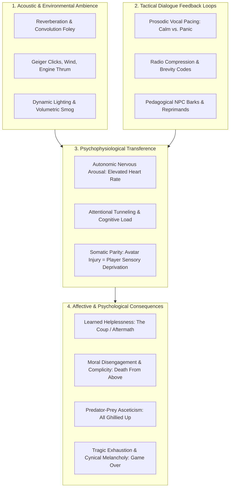
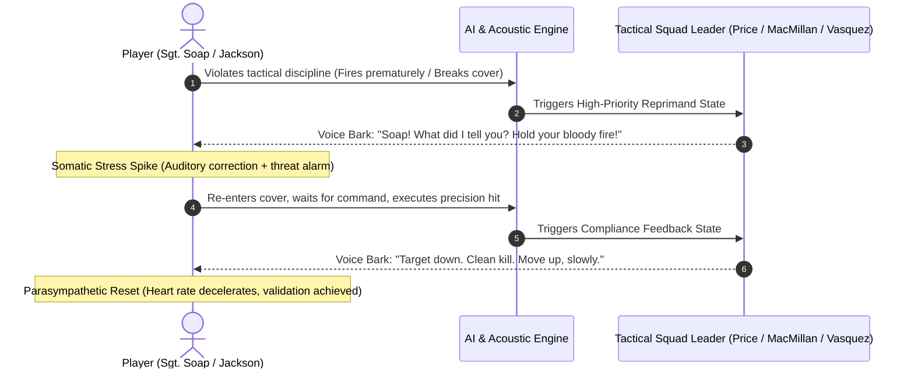
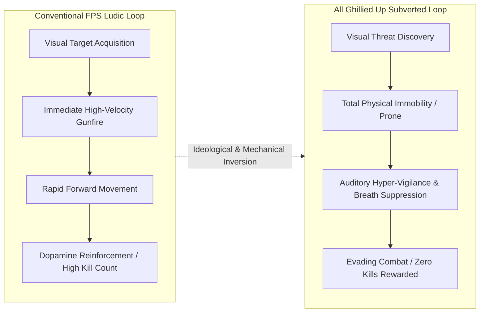
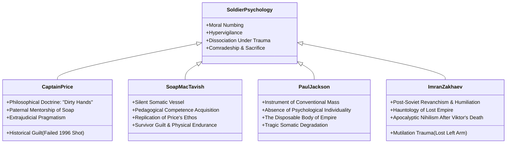
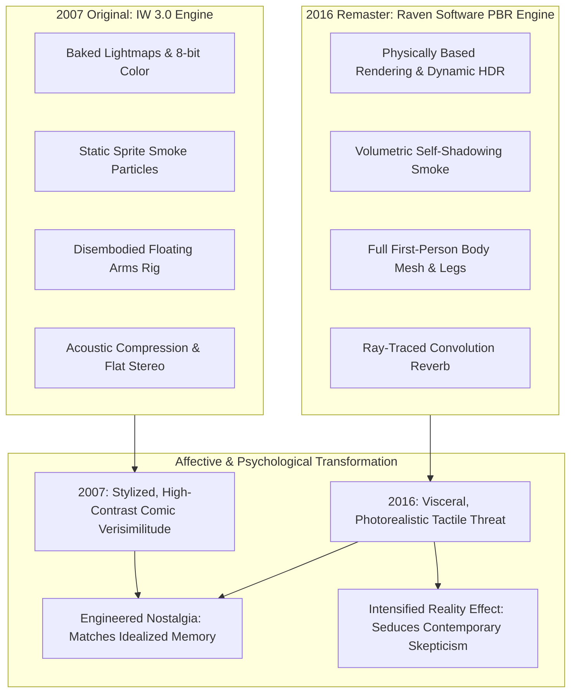

# 20. Mission Ambience, Dynamic Dialogue Feedback & Psychological Impact Analysis

**Title:** The Somatics of Interactive War: Ambient Acoustic Architecture, Tactical Dialogue Feedback Loops, and Player-Avatar Psychological Transference in *Call of Duty 4: Modern Warfare* (2007) and *Modern Warfare Remastered* (2016)  
**Author:** Antigravity Academic Research Consortium  
**Focus Disciplines:** Psychology of Interactive Media, Ludology, Acoustic Ecology, Critical Game Studies, Narrative Theory  
**Methodology:** Multimodal Discourse Analysis, Acoustic Semiotics, Cognitive-Affective Gameplay Profiling  

---

## 1. Executive Theoretical Introduction: Beyond Narrative Scripting

In critical discussions of military first-person shooters, analysis frequently gravitates toward macro-narrative themes: the representation of rogue states, the morality of pre-emptive strikes, or the subversion of heroic archetypes. However, an avatar's ideological persuasion does not occur through plot summaries; it is enacted somatically. It is generated through the sub-perceptual interplay of **ambient acoustic design**, **situational dialogue feedback systems**, and the **neurological manipulation of the player's autonomic nervous system**.

This monograph supplement delivers an exhaustive investigation into how *Call of Duty 4: Modern Warfare* orchestrates:
1. **Acoustic and Environmental Ambience:** How soundscapes, lighting gradients, dynamic particle density, and architectural geometry construct visceral spaces of dread, claustrophobia, and vulnerability.
2. **Dynamic Character Dialogue and Vocal Feedback Systems:** How non-player character (NPC) barks, radio frequency clipping, tactical brevity codes, and prosodic vocal delivery act as real-time biofeedback pacemakers for the player.
3. **The Dialectic of Character Psychology and Gamer Psychology:** How avatar trauma (hypervigilance, dissociation, moral numbing, survivor guilt) interfaces with player psychology (cognitive load, learned helplessness, somatic startle reflexes, and moral complicity).
4. **Exhaustive Anatomical Case Study on *All Ghillied Up* & *One Shot, One Kill*:** Deconstructing the legendary 1996 Chernobyl reconnaissance missions as a masterclass in the psychology of stillness, sensory deprivation, and evolutionary predator-prey dynamics.



---

## 2. The Acoustic Architecture of Ambience: Engineering Spatial Dread

The ambient environments of *Call of Duty 4* are not merely visual backdrops; they are psychoacoustic environments engineered to enforce specific cognitive states. Audio Director Mark Grigsby and sound designers Stephen Miller and Brian Tuey rejected the operatic, orchestral conventions of early 2000s military shooters in favor of a hyper-tactile, documentary sonic design.

### A. The Dialectic of Claustrophobia and Exposure
The campaign alternates violently between two spatial archetypes, each governed by contrasting acoustic and environmental mechanics:

| Spatial Archetype | Key Mission Examples | Ambient Acoustic Profile | Visual & Lighting Atmosphere | Primary Player Psychological Response |
|---|---|---|---|---|
| **The Claustrophobic Enclosure** | *Crew Expendable* (Lower Decks), *Blackout* (Cottage), *Safehouse* (Basements), *No Fighting in the War Room* (Silo corridors) | High-frequency slapback reflections; muffled engine thrum; dripping bilge water; metallic pipe groan; fluorescent bulb hum; sudden close-range weapon discharge (130dB peak). | Murky fluorescent flicker, darkness pierced by narrow tactical flashlight cones or night-vision green phosphor blooming; heavy industrial steam. | **Acute Hypervigilance:** High cognitive strain; corner-checking anxiety; fear of sudden point-blank shotgun or knife attacks; spatial paranoia. |
| **The Exposed Target Zone** | *The Bog* (Shantytown), *Charlie Don't Surf* (Streets), *Heat* (Downhill field), *Game Over* (Collapsed highway bridge) | Low-frequency ambient rumble; distant mortar concussions; erratic wind whistling; wide reverberant decay; multiple unsuppressed small-arms cracks overlapping across 360-degree vectors. | Blinding muzzle flashes in darkness; dense gray mortar smoke; tracer rounds searing across sightlines; total absence of vertical cover. | **Sensory Overload & Panic:** Breakdown of spatial orientation; inability to isolate specific threat vectors; feeling of extreme somatic fragility; vulnerability to explosive flanking. |

### B. Micro-Environmental Foley: Materiality as Ideological Truth
Semiotic authenticity in *Modern Warfare* is maintained through micro-foley details that Roland Barthes (1968/1986) identified as "the reality effect" (*l'effet de réel*):
1. **The Wet Deck of the Bering Strait (*Crew Expendable*):** Before a single bullet is fired, the player is enveloped in the roaring violence of a North Pacific storm. Rain lashes against Kevlar helmets with a persistent, sharp patter; heavy seas slam against the steel hull, producing deep, low-frequency structural groans that shake subwoofers; shoes squeak realistically against slick, rusted steel decking. This ambient density establishes somatic credibility: the player is not playing a video game; they are cold, wet, and physically endangered.
2. **The Domestic Ruins of Azerbaijan (*Safehouse*):** Inside the rustic village farmhouses, gunfire shatters porcelain plates, splintered wooden floorboards crunch under tactical boots, and battery-powered transistor radios emit faint, warbling local folk music before being silenced by stray 5.56mm rounds. The intrusion of clinical military violence into intimate, civilian domestic space generates a chilling atmospheric dissonance.
3. **The Subterranean Concrete Vault (*No Fighting in the War Room*):** The missile silo interior replaces natural environmental noise with the oppressive, industrialized hum of ventilation shafts, backup diesel generators, and the rhythmic, computerized automated warning claxons repeating Russian evacuation commands. The air feels heavy, recycled, and suffocating.

---

## 3. Dynamic Dialogue Feedback Loops: The NPC as Somatic Pacemaker

A defining technical and psychological innovation of *Modern Warfare* is its context-sensitive dynamic dialogue system. Unlike scripted cutscenes where characters speak to advance the plot, during gameplay NPCs speak to **regulate the player's somatic and tactical state**.



### A. The Prosodic Contrast: Captain MacMillan vs. Lieutenant Vasquez
The vocal performances in *Modern Warfare* are carefully tuned acoustic instruments. The difference in prosodic delivery between the British SAS and US Marine commanders produces profoundly different psychological environments:

#### 1. Captain MacMillan: The Maternal/Paternal Pacemaker of Calm
In *All Ghillied Up*, Captain MacMillan (voiced by Billy Murray) speaks almost exclusively in a low, resonant, Scottish whisper. His vocal register rarely exceeds 45 decibels, even when enemy tanks are grinding past inches away:
- *"Easy, lad... Don't make a sound."*
- *"Patience... There's a patrol coming. Go prone."*
- *"Wait... Four tangos. Let them pass... Alright, take the one on the left on my mark. Three... two... one... drop 'em."*

**Psychological Mechanism:** MacMillan’s voice operates as an **external vagal nerve stimulator**. In moments of extreme visual terror (such as an armored column traversing the grass where the player lies), the human brain naturally defaults to a fight-or-flight sympathetic response (pupil dilation, elevated heart rate, rapid breathing, tremor). MacMillan’s unwavering, rhythmic cadence acts as an auditory anchor, physically forcing the player to slow their breathing, suppress impulsive mouse clicks, and mirror his monastic patience.

#### 2. Lieutenant Vasquez: The Adrenaline-Soaked Pressure Cooker
In stark contrast, Lieutenant Vasquez (voiced by David Sobolov) commands the US Marines in the Middle East with a booming, raspy, gravelly baritone that perpetually hovers at maximum vocal exertion:
- *"Jackson! Get on that Mark 19 and lay down some suppressive fire on those tenements, now!"*
- *"We got RPGs on the second floor! Clear 'em out, Marines! Clear 'em out!"*
- *"Move, move, move! We are not leaving that pilot behind!"*

**Psychological Mechanism:** Vasquez’s vocal delivery induces **attentional funneling and high-arousal stress**. His perpetual vocal urgency mimics the physiological state of combat tachycardia (heart rate exceeding 140 BPM). The player is denied the luxury of contemplation; Vasquez’s screams flood the player's acoustic field, demanding continuous, aggressive kinetic output and driving forward momentum at the expense of tactical caution.

### B. The Radio Clipping Filter: The Sound of Technological Distance
Squad dialogue does not reach the player through clean digital channels. Infinity Ward’s audio engine routes all mid-distance and long-distance vocal tracks through a modeled **VHF/UHF radio distortion filter**:
- **Frequency Bandwidth Restriction:** Voice audio is sharply brick-wall filtered between 300 Hz and 3.4 kHz, stripping away low-end warmth and high-end airiness.
- **Dynamic Amplitude Compression & Clipping:** When an NPC screams or an explosion detonates near their microphone, the audio signal digitally distorts and breaks up into harsh harmonic clipping.
- **Micro-Squawk Barks:** Transmissions open and close with tactile, analog radio clicks and background rotor thrum.

**Affective Impact:** This technological degradation performs essential narrative work. It continuously signals to the player that their squadmates are physically separate bodies operating in hostile space. When an NPC’s voice crackles, distorts, and is swallowed by radio static during a firefight, the player experiences immediate auditory panic—the psychological dread of severed contact and imminent battlefield abandonment.

---

## 4. Deconstructing *All Ghillied Up* & *One Shot, One Kill*: The Masterclass in Somatic Asceticism

Among all missions in the historical canon of first-person shooters, the Act II flashback sequence to 1996 Chernobyl—comprising *All Ghillied Up* and *One Shot, One Kill*—stands as an unprecedented aesthetic rupture. It deliberately subverts every foundational premise of the military shooter genre.



### A. The Aesthetics of Inaction: Subverting the First-Person Shooter
Since *Wolfenstein 3D* (1992) and *Doom* (1993), the first-person shooter has operated on a dopamine feedback loop of aggressive spatial conquest: enter a room, acquire targets, discharge firearms, neutralize threats, and advance. 

In *All Ghillied Up*, level designer Mohammad Alavi executed a radical mechanical reversal (Alavi, 2023):
1. **The Weapon as Liability:** In Pripyat, firing a weapon is almost always a failure state. Unsuppressed fire instantly alerts dozens of heavily armed patrolling guards, armored infantry fighting vehicles (BMP-2s), and attack helicopters, resulting in swift, lethal punishment. The player must learn that their rifle is not an instrument of liberation, but a dangerous liability.
2. **The Asceticism of the Prone Stance:** Over 70% of *All Ghillied Up* is played crawling in the prone position. Movement speed is reduced to an agonizing crawl. The player's eye level is positioned mere inches above the dirt, forcing them to view the world through blades of irradiated grass and rusted vehicle undercarriages.
3. **The Ghillie Suit as Psychological Second Skin:** The titular ghillie suit is not merely an aesthetic skin; it transforms the player's relationship with game geometry. When lying still in tall grass, the player is practically invisible to enemy patrols. This creates a breathtaking psychological tension: the player must place absolute, counter-intuitive faith in their stillness. Every instinct urges the gamer to run or shoot; survival demands freezing completely, surrendering agency to the environment.

### B. The Soundscape of the Dead Zone
The ambient acoustic design of Pripyat is an eerie, haunting masterwork of acoustic ecology:

```
[Acoustic Breakdown: All Ghillied Up Environmental Layers]
├── Layer 1: The Invisible Menace (Geiger Counter)
│   ├── Baseline: Intermittent, rhythmic clicking (0.5 - 2 clicks/sec) -> Psychological Baseline
│   └── Proximity Spike: Rapid, violent, chaotic static (50+ clicks/sec) -> Somatic Terror / Spatial Revulsion
├── Layer 2: The Post-Apocalyptic Wind
│   ├── Low-frequency howling through shattered windowpanes of concrete brutalist apartments
│   └── Desolate rustling of dry autumnal reeds and radioactive foliage
├── Layer 3: Feral Nature Reclaiming Civilization
│   ├── Distant, echoic barking of wild, irradiated dog packs feeding on carrion
│   └── Total absence of songbirds or domestic ambient sounds -> Biotic Void
└── Layer 4: Distant Industrial Revanchism
    ├── Deep, ground-shaking diesel rumble of BMP-2 armored troop carriers
    └── Megaphone echoes of Russian Ultranationalist perimeter guards barking routine radio calls
```

#### The Geiger Counter as an Auditory Heartbeat
The most psychologically jarring acoustic device is the **Geiger counter**. In classical gaming, danger is communicated through direct visual indicators: red crosshairs, laser sights, or enemy outlines. Radiation, however, is an invisible, imperceptible threat. 

When the player wanders off the safe navigational path into irradiated drainage ditches or contaminated soil, the Geiger counter erupts into a frenzied, deafening auditory rattle. This noise acts as a profound acoustic repellant: players instinctively jerk their mouse away from the sound. The Geiger counter externalizes the player's mortality, transforming the landscape itself into a toxic, living antagonist.

### C. The Convoy Scene: Evolutionary Predator-Prey Transference
The defining moment of *All Ghillied Up* occurs when MacMillan orders Price to drop prone in an open field as an entire Ultranationalist armored column and infantry company sweeps across their path.

```
MacMillan: "Wait... hold your fire. Massive enemy convoy moving through. Get down!
Lie flat in the grass and don't make a twitch.
...
They're right on top of us. Keep still.
...
Steady... Don't panic. If they step on you, don't move.
...
He's looking right at us. Don't... bloody... move."
```

#### Psychoanalytic Deconstruction:
During this sequence, the game activates the primal, evolutionary neurology of **predator-prey dynamics**:
- **Loss of Top-of-the-Food-Chain Status:** In virtually all mainstream video games, the player is the ultimate predator. In this field, the player is reduced to an insect, a field mouse cowering beneath the boots of human giants.
- **Somatic Parity:** Players report physically holding their breath in real life as the boots of the Russian soldier brush past their screen. The sound of heavy combat boots crushing dry reeds inches from the player's ear canal, accompanied by the mechanical grinding of steel tank treads that shake the display, produces an excruciating psychophysiological tension.
- **The Terror of the Gaze:** When an enemy NPC pauses, turns, and stares directly in the player's direction, the game exploits our innate human terror of being discovered. The player’s finger tenses on the left mouse button, battling the desperate urge to fire first before being stepped on. MacMillan’s whispered command—*"He's looking right at us. Don't... bloody... move"*—enforces ironclad psychological discipline, converting panic into frozen endurance.

### D. The Ferris Wheel Standoff in *One Shot, One Kill*: The Collapse of Sanctuary
If *All Ghillied Up* is an exercise in monastic evasion, the climax of *One Shot, One Kill* at the Pripyat amusement park's decaying yellow Ferris wheel is its brutal, chaotic antithesis:
1. **The Inversion of Mastery:** After carrying the crippled Captain MacMillan across apartment ruins, the player must prop him against a rusted bumper car track. The mentor who previously possessed all knowledge and power is now physically helpless, entirely dependent on his student for survival.
2. **The Claustrophobia of Open Space:** The amusement park plaza offers zero solid structural cover. The player is surrounded 360 degrees by decaying Soviet architecture, rusted carnival rides, and desolate open tarmac.
3. **The Claymore Perimeter and the Psychological Countdown:** Waiting for the rescue helicopter (an excruciating 4-minute defensive hold against waves of infantry, attack dogs, and Mi-24 helicopters), the player experiences extreme spatial paranoia. Planting M18A1 Claymore directional mines and sprint-positioning behind carnival booths, the player watches their defensive perimeter systematically collapse. The triumphant high of the sniper shot at Zakhaev dissolves into a desperate, undignified scramble for pure survival.

---

## 5. Character Psychology: The Internal Landscape of Virtual Soldiers

The characters of *Call of Duty 4* are not traditional dramatic figures who explain their feelings in monologues; their psychologies are manifested through behavior under extreme fire.



### A. Captain John Price: The Tragic Pragmatist and "Dirty Hands"
Captain Price embodies what political philosopher Michael Walzer terms the problem of **"dirty hands"**: the conviction that political and military leaders must be willing to commit moral wrongs (assassination, torture, cross-border violations) to achieve necessary goods (preventing nuclear catastrophe).
- **The Burden of the 1996 Failure:** Price carries deep, unspoken psychological guilt. His 1996 sniper shot in Pripyat severed Imran Zakhaev's arm but failed to kill him. Every death in the 2011 campaign—the execution of Al-Fulani, the slaughter of Nikolai’s family, the nuclear obliteration of 30,000 Marines in the Middle East, the launch of the ICBMs—is the direct historical consequence of Price's miscalculation of the Coriolis effect fifteen years earlier.
- **Paternal Repression:** Price's mentorship of Soap is characterized by emotional withholding masked as tactical discipline. He rarely praises Soap directly; his approval is communicated through operational trust. Only at the ultimate brink of death on the collapsed bridge does Price reveal his desperate paternal devotion: throwing his personal M1911 pistol to Soap, sacrificing his own defense to ensure his student's survival.

### B. Sergeant Paul Jackson: The Disposable Vessel of Imperial Hubris
If Soap is Price's son, Sergeant Paul Jackson is Uncle Sam’s nameless cannon fodder:
- **The Psychology of the Cog:** Jackson possesses no dialogue, no family history, and no personal agency. He is the physical embodiment of the military-industrial apparatus. In *Charlie Don't Surf* and *War Pig*, Jackson’s psyche is flooded with the intoxicating illusion of American invulnerability: he is backed by laser-guided Cobra gunships, 70-ton Abrams tanks, and unlimited artillery.
- **The Shattering of the Power Fantasy:** In *Shock and Awe*, Jackson willingly risks his life to rescue Captain Pelayo, the downed helicopter pilot. This act of traditional Hollywood heroism is immediately revealed to be meaningless. The nuclear warhead detonates regardless. Jackson does not die in a glorious last stand; he dies alone in radioactive dirt, vomiting blood and gasping for air. His psychology is defined entirely by the horror of expendability: the realization that the empire he served deployed him into an apocalyptic trap without remorse.

### C. Imran Zakhaev: Revanchist Trauma and Apocalyptic Grief
Imran Zakhaev is not an ideological fanatic driven by religious ecstasy; he is driven by **imperial humiliation and profound grief**:
- **The Amputee’s Vengeance:** Having lost his left arm to Price in 1996, Zakhaev’s empty trench-coat sleeve is a permanent physical monument to Western violation. His illicit nuclear smuggling enterprise is an attempt to restore the fractured potency of the Russian state.
- **The Psychological Pivot of Viktor's Suicide:** The narrative pivot of *Call of Duty 4* occurs not in an international summit, but on a grimy Russian tenement rooftop in *The Sins of the Father*. When Viktor Zakhaev corners himself and puts a pistol in his mouth to prevent capture, Imran Zakhaev’s psychological restraint collapses entirely. He ceases to be a rational geopolitical actor calculating power; he becomes a grieving, vengeful father willing to incinerate 41 million American civilians on the Eastern Seaboard simply to make the world share his pain.

---

## 6. Gamer Psychology: Somatics, Cognitive Load, and Moral Complicity

What happens to the mind of the player holding the mouse or game controller across *Modern Warfare*'s twenty-one missions? The game orchestrates a sophisticated psychological journey characterized by shifting cognitive states:

### A. The Illusion of Agency and Learned Helplessness
Psychologist Martin Seligman’s theory of **learned helplessness** occurs when an organism is repeatedly subjected to aversive stimuli that it cannot escape or control, eventually leading to the cessation of all resistance. 

*Call of Duty 4* deploys this psychological state with surgical precision:
1. **The Coup:** The player begins the mission expecting traditional movement controls. Pressing `W`, `A`, `S`, `D` yields zero locomotive response; the player can only pan the camera within the backseat of a moving sedan. The player is forced to endure verbal insults, see civilians gunned down in alleyways, and be dragged to a public execution post. When Al-Asad raises the gold Desert Eagle, players instinctively smash the melee or fire keys. Nothing happens. The screen cuts to red, then black. The player’s will to act is fundamentally broken.
2. **Aftermath:** Following the nuclear explosion, the player crawls out of the Sea Knight wreckage. The HUD is completely erased—no ammunition counters, no compass, no objective marker. The sprint key (`Shift`) and jump key (`Space`) are disabled. The player moves at a painfully sluggish, dying stagger. For five full minutes, the player wanders through burning playgrounds and melting concrete, desperately searching for an extraction helicopter, a medical kit, or a squadmate. When Jackson eventually collapses, rolls onto his back, and watches the towering mushroom cloud as his heart monitor flatlines, the player experiences profound cognitive resignation. The game forces the player to accept that within modern nuclear war, human skill, reflexes, and agency are entirely irrelevant.

```
[Affective State Shift: The Traumatic Disempowerment Sequence]
Standard Shooter Fantasy       -> Sudden System Disruption      -> Learned Helplessness & Shock
-----------------------          -------------------------         -----------------------------
• Omnipotent Movement (Sprint)   • Stripped HUD & Weapon Loss     • Inability to Alter Outcome
• Health Regeneration on Cover   • Audio Tinnitus / Red Glare     • Inhabiting Avatar's Demise
• Clear Objective Markers        • Heavy, Sluggish Locomotion     • Somatic Grief & Exhaustion
```

### B. *Death From Above*: The Psychology of Moral Complicity
In *Death From Above*, the psychological dynamic shifts from helplessness to **moral disengagement** (Bandura, 1999).
- **The God's-Eye Perspective:** The player is placed in an orbiting AC-130 gunship, looking down through a high-contrast infrared thermal monitor. The world is rendered in cold, clinical black-and-white.
- **De-Individualization of Victims:** Human beings are reduced to tiny, flickering white thermal signatures. When an artillery shell detonates, the targets do not scream, bleed, or writhe in agony; they simply disintegrate into harmless puffs of digital smoke.
- **The Banality of Technological Evil:** The flight crew's conversational dialogue is deliberately casual, mundane, and jovial:
  - *"Yeah, good kill. That's a hit."*
  - *"Kaboom."*
  - *"Ooh, you got him. Look at that guy scatter."*
- **The Gamer's Complicity:** Most critically, the sequence is enormously mechanically satisfying. The 105mm howitzer has a massive blast radius, smooth ballistic arc, and immediate screen-shaking feedback. The player catches themselves laughing along with the flight crew, enjoying the effortless, god-like slaughter. It is only after the mission ends that the cognitive dissonance sets in: the player realizes they have been seduced into gleefully enacting the detached, technocratic slaughter of real-world virtuous war (Der Derian, 2009; Stahl, 2010).

### C. Cognitive Load and Attentional Tunneling under Countdown Timers
In *No Fighting in the War Room*, the player is subjected to extreme **cognitive load**:
- **The 8-Minute Countdown:** A massive red digital countdown timer anchors the top of the HUD, accompanied by urgent, high-BPM synth percussion that accelerates in tempo.
- **Attentional Tunneling:** Under extreme time pressure, the human brain suffers from perceptual narrowing (tunnel vision). Players stop scanning corners, ignore weapon pickups, and default to reckless, aggressive forward breaches.
- **The Cognitive Shock of the Abort Sequence:** When the player finally reaches the missile control terminal, the game does not reward them with a cinematic cutscene. Instead, the player must manually stand exposed in the center of the control deck, interact with the computer, and wait for confirmation while enemies continue to pour in from catwalks above. The cognitive friction between the urgent desire to survive and the mechanical requirement to stand still and upload codes pushes player anxiety to its absolute zenith.

---

## 7. Comparative Ambience: 2007 Original vs. 2016 Remaster

Raven Software’s 2016 remaster (*Modern Warfare Remastered*) did not merely upgrade visual resolution; it transformed the **affective atmosphere** of the game through modern rendering pipelines:



### Detailed Atmospheric Comparison Matrix

| Ambient Dimension | 2007 Original (*Call of Duty 4*) | 2016 Remaster (*Modern Warfare Remastered*) | Impact on Player Psychology & Ambience |
|---|---|---|---|
| **Atmospheric Density in Pripyat (*All Ghillied Up*)** | Flat skyboxes; low foliage density; sparse grass cards that clip through models; clean, sharp edges. | Volumetric mist rolling across roads; high-density 3D wind-simulated grass; realistic wet mud puddles with sky reflections; decaying moss peeling off brutalist concrete. | **Deepened Melancholy & Isolation:** Pripyat feels genuinely decaying and bio-hazardous; grass movement in the wind heightens panic when armored patrols approach. |
| **Volumetric Lighting in *Crew Expendable*** | Baked light cones with harsh edge transitions; static yellow incandescent glow in ship cabins. | Dynamic volumetric light shafts scattering through airborne water droplets; deep dynamic shadows cast by swaying overhead lamps on pitching decks. | **Enhanced Vertigo & Disorientation:** The swaying light sources simulate the physical nausea of the storm, intensifying somatic immersion during the vertical escape. |
| **Nuclear Fallout in *Aftermath*** | Red screen tint; 2D particle cards floating horizontally; flat gray ash textures on buildings. | Volumetric radioactive dust storm with dynamic light scattering; glowing radioactive embers swirling in thermal winds; realistic skin blistering and ash accumulation on avatar's gloves. | **Horrific Viscerality:** The nuclear wasteland ceases to be an abstract set-piece; it resembles authentic documentary footage of industrial catastrophes (Hiroshima / 9/11 Ground Zero). |
| **Weapon Foley & Acoustic Punch** | Punchy but compressed stereo small-arms samples; static indoor reverb triggers; dialogue sits cleanly atop mix. | Re-recorded live-fire weapons using multi-mic array; authentic dynamic mechanical clatter; supersonic ballistic snaps that cause physical auditory flinching. | **Instinctive Somatic Reflexes:** Ballistic cracks now provoke involuntary ducking reflexes; weapons possess terrifying, ear-ringing physical violence. |

---

## 8. Synthesis: Ambience, Dialogue, and the Engineering of Modern War

Our deep dive into the ambient architecture, dialogue feedback loops, and psychophysiological mechanics of *Call of Duty 4: Modern Warfare* exposes how interactive military media achieves its ideological power. 

The game does not persuade players that modern warfare is necessary through explicit political propaganda or philosophical debate. Instead, it persuades through **sensory and somatic conditioning**:
1. It immerses the player in an acoustic and visual landscape so meticulously tactile and authentic—from the rain-lashed decks of the Bering Strait to the clicking Geiger counters of Chernobyl—that the player's critical skepticism is completely disarmed by Barthes' **Reality Effect**.
2. It uses the calm, paternal voice of Captain MacMillan and the rhythmic feedback of squad barks as **biological pacemakers**, training the player to equate emotional maturity with clinical, lethal self-control.
3. It alternates violently between the intoxicating empowerment of combined-arms mass, the detached god-like slaughter of the AC-130, and the traumatizing helplessness of nuclear annihilation, leaving the player in a state of **affective exhaustion**.

Ultimately, in *Modern Warfare*, war is not an abstract political contest; it is a full-body somatic experience of sound, stillness, panic, and obedience. By engineering a virtual reality where lethal competence is the only shield against invisible radioactive death and apocalyptic terror, *Call of Duty 4* constructed the definitive interactive psychological template of twenty-first-century conflict.

---

## References

- Alavi, M. (2023, October 27). *Call of Duty 4: Modern Warfare’s* most iconic mission was a hard sell internally (Interview by D. Hornshaw). *GameSpot*. https://www.gamespot.com/articles/cod-4-modern-warfares-most-iconic-mission-was-a-hard-sell-internally-nobody-thought-it-was-cool/1100-6518706/
- Bandura, A. (1999). Moral disengagement in the perpetration of inhumanities. *Personality and Social Psychology Review*, 3(3), 193–209. https://doi.org/10.1207/s15327957pspr0303_3
- Barthes, R. (1986). The reality effect (*L'effet de réel*). In *The rustle of language* (R. Howard, Trans., pp. 141–148). Hill and Wang. (Original work published 1968).
- Bogost, I. (2007). *Persuasive games: The expressive power of videogames*. MIT Press. https://doi.org/10.7551/mitpress/5334.001.0001
- Bos, D. (2018). The real and the unreal: Touring Chernobyl in virtual and digital spaces. *Area*, 50(4), 515–523. https://doi.org/10.1111/area.12423
- Cao, K. D. (2024). Military violence in video games: Defining and representing the real in Call of Duty 4 Modern Warfare. *Journal of Integrated Studies*, 15(1), 1–14. https://jis.athabascau.ca/index.php/jis/article/view/422
- Der Derian, J. (2009). *Virtuous war: Mapping the military-industrial-media-entertainment network* (2nd ed.). Routledge. https://doi.org/10.4324/9780203875360
- Payne, M. T. (2016). *Playing war: Military video games after 9/11*. New York University Press. https://doi.org/10.18574/nyu/9781479805228.001.0001
- Pötzsch, H. (2017). Selective realism: Filtering experiences of war and violence in first- and third-person shooters. *Games and Culture*, 12(2), 156–178. https://doi.org/10.1177/1555412015587802
- Ramsay, D. (2015). Liminal spaces: Modern Warfare and the aesthetics of the post-9/11 military FPS. *Game Studies*, 15(2). http://gamestudies.org/1502/articles/ramsay
- Seligman, M. E. (1975). *Helplessness: On depression, development, and death*. W. H. Freeman.
- Stahl, R. (2010). *Militainment, Inc.: War, media, and popular culture*. Routledge. https://doi.org/10.4324/9780203873298

